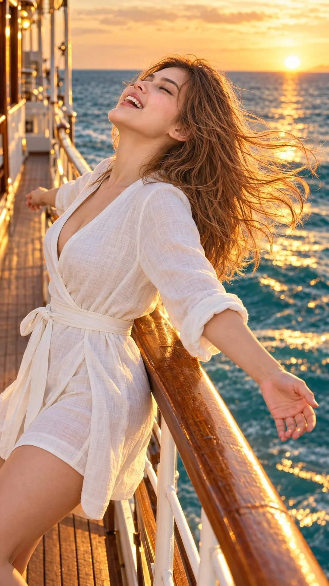

# Golden-Hour Boat Lifestyle Portrait (Netflix Style)

**中文标题：** 金色时光船甲板生活人像（Netflix 风）  
**ID:** `gi25-x-843` · **Mode:** `edit`  
**Categories:** `general`, `character-consistency`  
**Tags:** `x-twitter`, `community`, `gpt-image-2.5`, `x-direct`, `en`



### Golden-Hour Boat Lifestyle Portrait (Netflix Style)

```text
Hyper-realistic IMAX-level Netflix-style cinematic golden-hour lifestyle portrait, 9:16 vertical. Use the uploaded image as the primary visual reference and preserve the exact facial identity, proportions, and defining features. Create a woman wearing an elegant white linen wrap-style outfit with a V-neckline, three-quarter sleeves loosely rolled at the forearms and a matching fabric belt tied around her waist. She leans backward against the polished wooden railing of a boat, her torso angled diagonally toward the left side of the frame; her back rests lightly against the railing, her head tilts far backward with her chin lifted toward the sky, and both arms extend freely outward in opposite directions, with one arm reaching behind her toward the left and the other stretching diagonally toward the lower right, palm open and fingers naturally relaxed. Her eyes are closed, eyebrows relaxed, and mouth open in a broad, spontaneous laugh, conveying pure joy and freedom. Her long, dark chestnut-brown hair is blown dramatically backward toward the right by the sea breeze, with individual strands streaming horizontally away from her face. Fair luminous porcelain skin with a bright ivory to light beige tone and a neutral-cool undertone, featuring natural realistic texture and soft highlights warmed by the sunset. The boat's wooden deck and white metal railing extend into the distance along the left side, while turquoise seawater fills the right background. The low setting sun glows near the horizon, casting a brilliant golden path across the moving waves. Strong warm backlighting creates a luminous rim around her windblown hair and shoulders, while reflected sunlight dances across the water and adds golden highlights to the white fabric. Rich cinematic colour grading combines molten gold and amber sunlight with turquoise and teal water, warm honey-toned wood, creamy whites, deep natural shadows and controlled highlights, with subtle atmospheric glow, realistic water reflections and a polished filmic finish. 
Negative prompt: changed identity, incorrect leaning angle, wrong arm positions, static hair, stiff expression, distorted hands, extra fingers, bad anatomy, plastic skin, excessive smoothing, text, watermark.
```

- **Recommended model:** `gpt-image-2.5-sunburst`
- **Settings:** _(defaults)_
- **Source:** [community](https://x.com/imGopalTiwari/status/2108771756588630176) — @imGopalTiwari
- **License note:** Original public X post; quoted with attribution — remix with attribution
- **Notes:** Collected directly from X; original post https://x.com/imGopalTiwari/status/2108771756588630176; post text names GPT Image 2.5; discovered via Bin0754/gpt-image-gallery index, prompt re-verified against the original X post via api.fxtwitter.com; verified=True
- **Preview:** `previews/gi25-x-843.webp`
