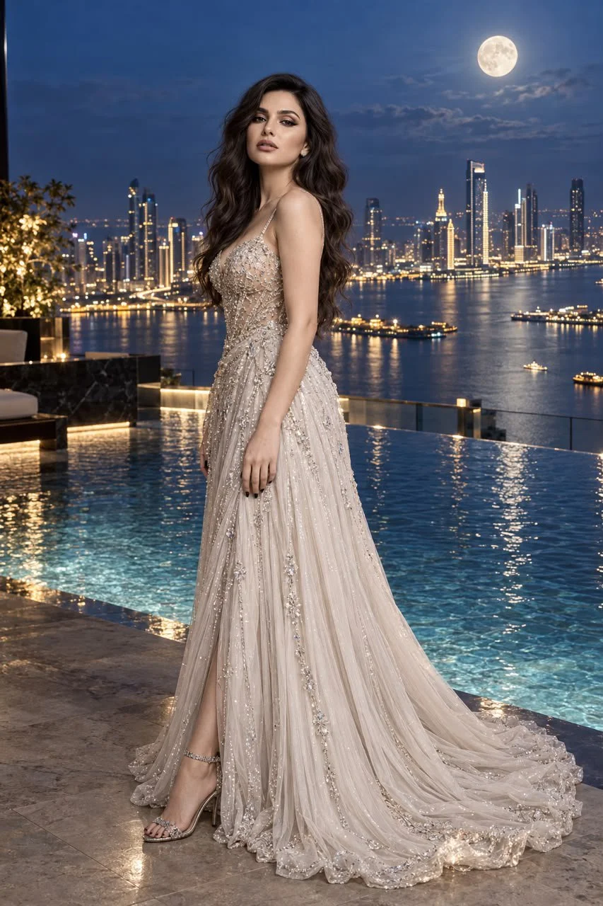

# Infinity-Pool Blue-Hour Couture Portrait

**中文标题：** 无边际泳池蓝调时刻高级定制人像  
**ID:** `gi25-x-844` · **Mode:** `edit`  
**Categories:** `general`, `character-consistency`  
**Tags:** `x-twitter`, `community`, `gpt-image-2.5`, `x-direct`, `en`



### Infinity-Pool Blue-Hour Couture Portrait

```text
Use the uploaded image as the exact identity reference. Preserve the woman’s facial features, proportions, hairstyle, and natural appearance with zero identity drift.

Create an ultra-photorealistic luxury fashion portrait of her standing beside an infinity pool overlooking an illuminated waterfront city at blue hour. She wears a floor-length silver-white couture gown with delicate straps, a crystal-embellished fitted bodice, flowing pleated skirt, subtle train, and sparkling silver heels.

Maintain the graceful side-profile pose, body slightly angled toward the camera, relaxed shoulders, one arm naturally at her side, and a soft, confident gaze toward the viewer.

The pool reflects the city lights realistically. Tall illuminated skyscrapers create cinematic depth, while a naturally sized full moon glows in the deep blue sky. A gentle breeze subtly moves her hair and gown.

Lighting: Soft moonlight, ambient architectural lights, realistic shadows, delicate dress highlights, natural skin tones, and subtle atmospheric haze.

Camera: Full-body composition, eye-level, 85mm portrait lens, shallow depth of field, realistic bokeh, sharp facial details, natural skin pores, and intricate fabric texture.

Style: High-end luxury fashion editorial, cinematic, sophisticated, exceptionally photorealistic, natural proportions, no artificial AI appearance.

Negative prompt: Identity drift, altered face, oversized moon, plastic skin, excessive retouching, distorted anatomy, deformed hands, extra fingers, unnatural pose, unrealistic reflections, CGI, oversaturation, excessive glow, duplicate person, blurry face, text, watermark, logo.
```

- **Recommended model:** `gpt-image-2.5-sunburst`
- **Settings:** _(defaults)_
- **Source:** [community](https://x.com/mehvishs25/status/2108916884460704238) — @mehvishs25
- **License note:** Original public X post; quoted with attribution — remix with attribution
- **Notes:** Collected directly from X; original post https://x.com/mehvishs25/status/2108916884460704238; post text names GPT Image 2.5; discovered via Bin0754/gpt-image-gallery index, prompt re-verified against the original X post via api.fxtwitter.com; verified=True
- **Preview:** `previews/gi25-x-844.webp`
