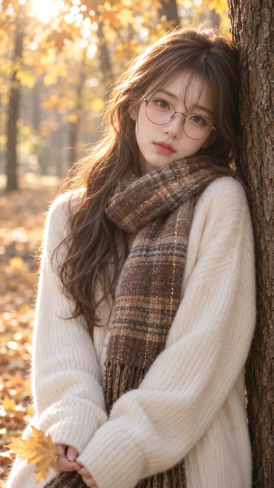

# Autumn Soft-Focus Tree-Lean Portrait

**中文标题：** 秋日柔焦倚树人像  
**ID:** `gi25-x-850` · **Mode:** `generate`  
**Categories:** `general`  
**Tags:** `x-twitter`, `community`, `gpt-image-2.5`, `x-direct`, `zh`



### Autumn Soft-Focus Tree-Lean Portrait

```text
9:16竖画幅，数码相机柔焦人像写真质感，呈低饱和暖金、米白与栗棕交织的秋日色调，带唯美柔光漫射效果。平视中近景构图，兼具大姐姐与弱娇气质的冷白皮少女居画面偏右侧，无前景遮挡。她身体微向左侧倾，后背与左肩慵懒倚靠在画面右侧边缘粗糙的深棕树干上，头颈微向树干侧倾并正对镜头。双臂自然相拢垂于身前，双手藏于宽松的米白色毛衣长袖口内，指尖在左下角边缘轻轻捏着一片金黄落叶。栗棕色微卷长发配轻薄刘海，鼻梁上架着纤细的金属圆框眼镜，颈间层叠缠绕带有细闪亮丝的咖色格纹粗花呢围巾，身穿软糯的米白色竖条纹针织开衫，粗糙树皮、蓬松针织与微闪围巾形成鲜明材质反差。她透过镜片眼神迷离温润地凝视镜头，上眼睑松弛微垂，下巴轻轻埋入厚实的围巾褶皱中，粉润的双唇想要微启倾诉却在秋日微凉的空气中轻轻抿住 🥺✨。左上方温暖的秋日阳光呈顶逆光穿透枝叶倾洒，在发顶绒毛与肩线勾勒出琥珀色高光勾边，树荫下的漫射天光令冷白面部肌肤透出蜜桃粉次表面漫反射与温润薄瓷光泽。画面交织出微醺幻觉与浮生空灵的秋日氛围，背景为大光圈奶油虚化的金黄秋叶树冠与柔和林间光斑。
```

- **Recommended model:** `gpt-image-2.5-sunburst`
- **Settings:** _(defaults)_
- **Source:** [community](https://x.com/alanblogsooooo/status/2110634773232366067) — @alanblogsooooo
- **License note:** Original public X post; quoted with attribution — remix with attribution
- **Notes:** Collected directly from X; original post https://x.com/alanblogsooooo/status/2110634773232366067; post text names GPT Image 2.5; discovered via Bin0754/gpt-image-gallery index, prompt re-verified against the original X post via api.fxtwitter.com; verified=True
- **Preview:** `previews/gi25-x-850.webp`
