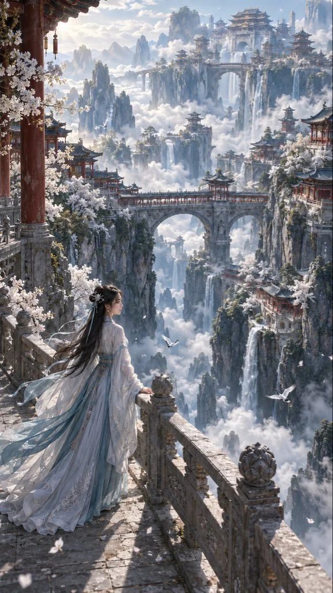

# Eastern Surreal Celestial-Palace Landscape

**中文标题：** 东方超现实仙宫云海景观  
**ID:** `gi25-x-851` · **Mode:** `generate`  
**Categories:** `general`  
**Tags:** `x-twitter`, `community`, `gpt-image-2.5`, `x-direct`, `zh`



### Eastern Surreal Celestial-Palace Landscape

```text
9:16竖版，东方超现实仙境，电影级写实质感。高耸山体悬于云海，两侧青灰瓦顶、朱红廊柱的仙宫依崖层叠，巨型石拱桥跨越深渊，白色花树沿宫墙盛开，细长瀑布垂入云层，远景宫阙隐入淡蓝薄雾，空间纵深震撼。

近景左侧，一位成年东方女性站在石质回廊内，侧背身眺望仙宫，微微侧头露出柔和侧脸，一手轻搭石栏。黑发半挽、玉簪点缀，身穿月白淡青汉服，丝绸裙摆自然垂落，轻纱衣袖与发丝随风扬起。镜头从侧后方略高处拍摄，栏杆斜向引导视线进入云海。两只白鹤分散于不同远近位置，轮廓独立、双翼舒展、结构自然，无交叠重影。左上方柔和晨光，人物与环境光影统一，皮肤与织物保留细节，青灰月白主色，少量朱红暗金，无过度磨皮、锐化、过曝，无文字水印。
```

- **Recommended model:** `gpt-image-2.5-sunburst`
- **Settings:** _(defaults)_
- **Source:** [community](https://x.com/krienknight/status/2110678569873731795) — @krienknight
- **License note:** Original public X post; quoted with attribution — remix with attribution
- **Notes:** Collected directly from X; original post https://x.com/krienknight/status/2110678569873731795; post text names GPT Image 2.5; discovered via Bin0754/gpt-image-gallery index, prompt re-verified against the original X post via api.fxtwitter.com; verified=True
- **Preview:** `previews/gi25-x-851.webp`
