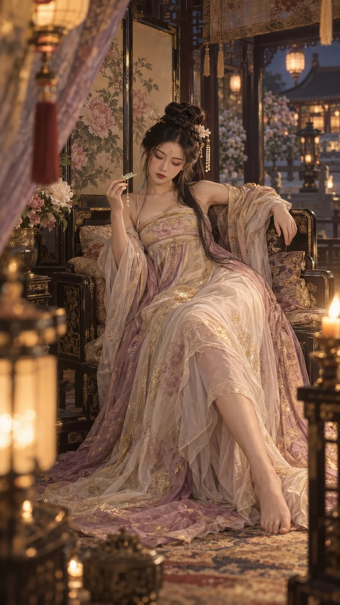

# Tang-Dynasty Night-Banquet Pavilion Portrait

**中文标题：** 盛唐夜宴牡丹书画亭人像  
**ID:** `gi25-x-855` · **Mode:** `generate`  
**Categories:** `general`  
**Tags:** `x-twitter`, `community`, `gpt-image-2.5`, `x-direct`, `zh`



### Tang-Dynasty Night-Banquet Pavilion Portrait

```text
9:16纵向超写实宫廷人像，主题为盛唐夜宴后的静谧余韵。场景更换为宫苑内封闭的牡丹书画亭，深木框架、金线屏风、帘幕、散射宫灯和远处模糊庭院共同构成安全私密的空间。一位成年东亚女性，清秀瓜子脸、柔和高颧骨、微圆小下巴与慵懒凤眼，皮肤细腻真实，朱砂唇色鲜明，脸颊带淡淡暖红。乌黑头发编成环绕式皇冠辫并收成高髻，长发尾从一侧垂落，搭配白玉发簪、珍珠流苏和花瓣形额饰。她穿轻薄浅茶金、雾粉紫与象牙白配色的唐风宫廷长裙，保留齐胸高腰结构、层叠半透明纱料、宽幅丝质披帛和精美金线刺绣。人物靠坐在具有厚软靠垫的雕漆罗汉椅上，一侧身体陷入靠垫，一腿从裙摆下向前延展，另一腿轻微屈起；一手沿靠背自然垂落，另一手握着一支细长玉簪，正在缓慢松开发髻，几缕头发随动作滑落肩头。她低头注视玉簪，神态倦懒含蓄。35mm稍低机位全身构图，前景纱帘与灯穗虚化遮挡，烛光营造强烈柔晕、细颗粒和轻微CCD失焦。不要勺子、饮酒器具、现代用品、文字、水印、塑料皮肤或错误解剖。
```

- **Recommended model:** `gpt-image-2.5-sunburst`
- **Settings:** _(defaults)_
- **Source:** [community](https://x.com/Mrpinecone888/status/2110704543256428795) — @Mrpinecone888
- **License note:** Original public X post; quoted with attribution — remix with attribution
- **Notes:** Collected directly from X; original post https://x.com/Mrpinecone888/status/2110704543256428795; post text names GPT Image 2.5; discovered via Bin0754/gpt-image-gallery index, prompt re-verified against the original X post via api.fxtwitter.com; verified=True
- **Preview:** `previews/gi25-x-855.webp`
