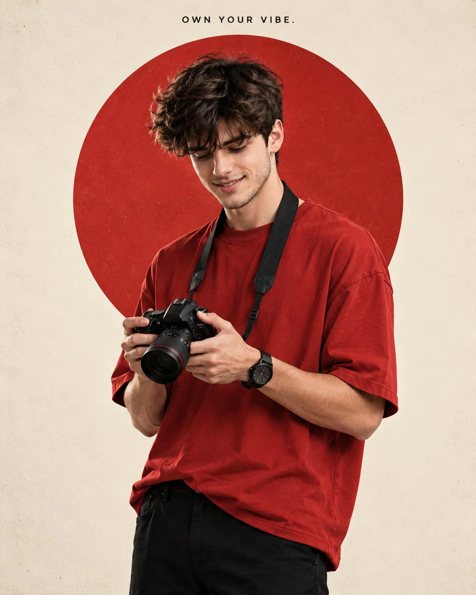

# Own-Your-Vibe Male Editorial Circle Portrait

**中文标题：** 「OWN YOUR VIBE」男性编辑圆环人像  
**ID:** `gi25-x-856` · **Mode:** `generate`  
**Categories:** `general`  
**Tags:** `x-twitter`, `community`, `gpt-image-2.5`, `x-direct`, `en`



### Own-Your-Vibe Male Editorial Circle Portrait

```text
Create Photorealistic editorial 4:5 portrait of a young man standing mostly straight in a relaxed, stylish pose, body turned slightly sideways so his chest is not directly facing the camera, with one shoulder subtly angled forward. He

is not too thin, with natural, balanced proportions. He wears an oversized red short-sleeve T-shirt, black pants, black wristwatch, and black camera strap, holding a black

DSLR camera naturally with both hands, slightly away from his face. He looks slightly downward at the camera he is holding, not at his eyes, with a soft, happy, confident smile. Thick curly dark hair. Clean warm off-white/cream background with a large red circle positioned directly behind his upper shoulders and head, with his hair and

shoulder overlapping into the circle. Soft studio lighting, subtle vintage texture, clean minimal composition, realistic proportions. Small black uppercase text "OWN YOUR VIBE." centered at the very top above the circle.
```

- **Recommended model:** `gpt-image-2.5-sunburst`
- **Settings:** _(defaults)_
- **Source:** [community](https://x.com/harboriis/status/2110714603965726893) — @harboriis
- **License note:** Original public X post; quoted with attribution — remix with attribution
- **Notes:** Collected directly from X; original post https://x.com/harboriis/status/2110714603965726893; post text names GPT Image 2.5; discovered via Bin0754/gpt-image-gallery index, prompt re-verified against the original X post via api.fxtwitter.com; verified=True
- **Preview:** `previews/gi25-x-856.webp`
