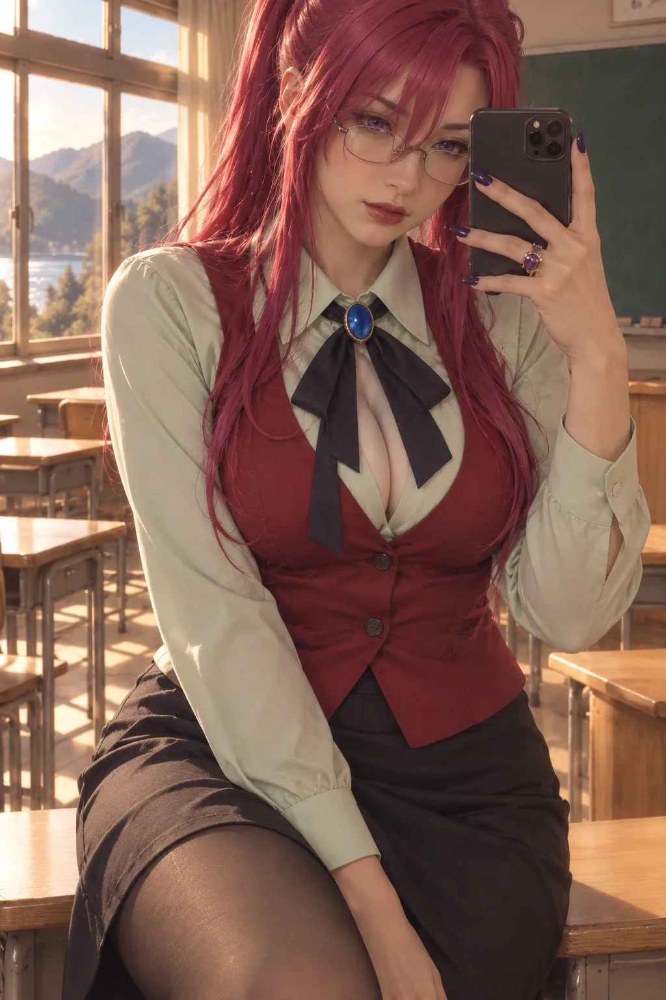

# Mizuho Kazami Cosplay Portrait

**中文标题：** 风见水穗 Cosplay 人像  
**ID:** `gi25-x-859` · **Mode:** `generate`  
**Categories:** `general`  
**Tags:** `x-twitter`, `community`, `gpt-image-2.5`, `x-direct`, `en`



### Mizuho Kazami Cosplay Portrait

```text
Ultra-photorealistic cosplay portrait of Mizuho Kazami from Onegai☆Teacher, clearly adult Japanese woman, gentle mature face, violet eyes, thin oval glasses, long reddish-pink hair in her signature high ponytail, faithful cosplay of her iconic outfit: pastel-green blouse, crimson-red vest, dark neck ribbon with blue oval ornament, black skirt. Standing in a nostalgic Japanese classroom with warm afternoon sunlight, holding a textbook, soft smile, sweet teacher aura, elegant pose, highly detailed fabrics, cinematic lighting, authentic premium cosplay photography, textless.
```

- **Recommended model:** `gpt-image-2.5-sunburst`
- **Settings:** _(defaults)_
- **Source:** [community](https://x.com/livybabie/status/2110718938145292295) — @livybabie
- **License note:** Original public X post; quoted with attribution — remix with attribution
- **Notes:** Collected directly from X; original post https://x.com/livybabie/status/2110718938145292295; post text names GPT Image 2.5; discovered via X search, prompt re-verified against the original X post via api.fxtwitter.com; verified=True
- **Preview:** `previews/gi25-x-859.webp`
