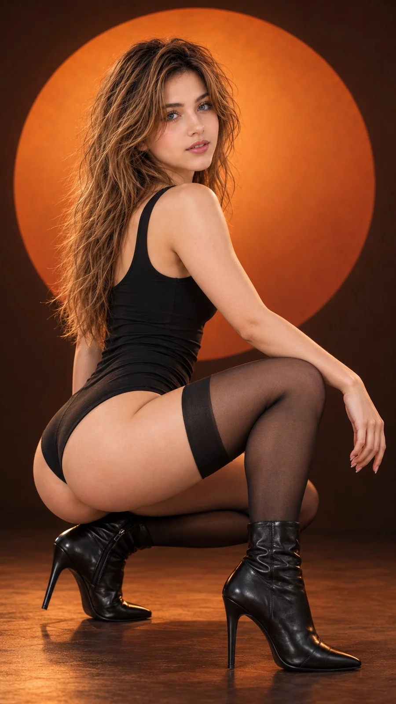

# Studio Fashion Portrait (Netflix Style)

**中文标题：** 棚拍时装人像（Netflix 风）  
**ID:** `gi25-x-861` · **Mode:** `edit`  
**Categories:** `general`, `character-consistency`  
**Tags:** `x-twitter`, `community`, `gpt-image-2.5`, `x-direct`, `en`



### Studio Fashion Portrait (Netflix Style)

```text
Hyper-realistic IMAX-level Netflix-style cinematic studio fashion portrait, 9:16 vertical. Use the uploaded image as the primary visual reference and preserve the exact facial identity, proportions, and defining features. Create a woman wearing a sleek, fitted black sleeveless bodysuit with a clean neckline and opaque black thigh-high stockings, paired with black high-heeled ankle boots. She holds a deep, low crouching pose with one knee bent close to the floor, the other thigh raised horizontally across her body, and her torso upright with a subtle backward curve. Her upper body turns three-quarters away from the camera while her head rotates over her shoulder toward the lens. One arm extends diagonally downward across the raised thigh, with her hand resting loosely over the knee and fingers naturally hanging; the other arm remains mostly concealed behind her torso. Her face has a composed, confident expression, with slightly narrowed eyes directed toward the camera, softly defined eyebrows, and gently parted lips. Her long, dark-brown hair is parted near the center and falls naturally in smooth, loose waves down her back, with a few strands framing her face. Behind her, a large, softly feathered circular burnt-orange backdrop glows against a dark chocolate-brown studio wall, creating a bold sun-disc effect, while the matte brown floor fades gently into shadow. Use controlled directional studio lighting from the front and side, softly illuminating her face, shoulder, and extended arm while preserving deep shadows across the black outfit and lower body. Apply cinematic warm-amber colour grading with rich burnt-orange highlights, muted chocolate-brown shadows, restrained saturation, deep blacks, subtle film grain, and smooth tonal transitions for a sophisticated editorial finish. Fair luminous porcelain skin with a bright ivory to light beige tone and a neutral-cool undertone, with natural realistic skin texture, visible pores, subtle natural imperfections and soft realistic highlights, balanced with the warm studio illumination without looking overly orange or airbrushed. Frame the complete crouching pose from head to boots at a slightly low camera angle, placing the subject near the centre of the circular backdrop with generous negative space and crisp, realistic details.

Negative prompt: changed identity, distorted face, bad anatomy, deformed hands or fingers, incorrect crouching pose, plastic skin, harsh oversaturation, text, watermark.
```

- **Recommended model:** `gpt-image-2.5-sunburst`
- **Settings:** _(defaults)_
- **Source:** [community](https://x.com/imGopalTiwari/status/2110805412262105575) — @imGopalTiwari
- **License note:** Original public X post; quoted with attribution — remix with attribution
- **Notes:** Collected directly from X; original post https://x.com/imGopalTiwari/status/2110805412262105575; post text names GPT Image 2.5; discovered via X search, prompt re-verified against the original X post via api.fxtwitter.com; verified=True
- **Preview:** `previews/gi25-x-861.webp`
