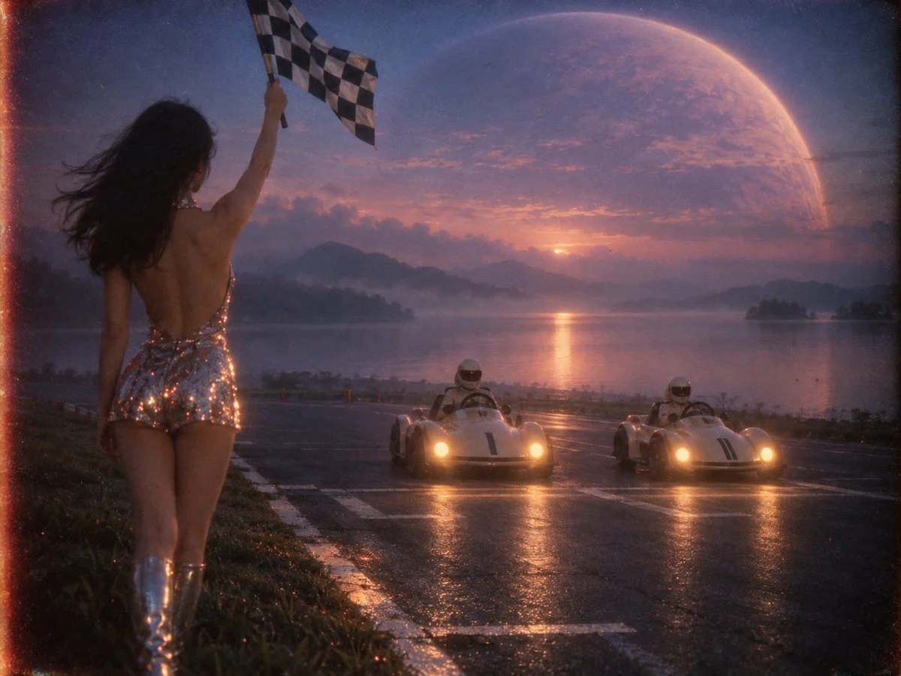

# Dreamcore Lakeside Karting Retro-Futurist Scene

**中文标题：** 梦核湖畔卡丁复古未来场景  
**ID:** `gi25-x-863` · **Mode:** `generate`  
**Categories:** `general`  
**Tags:** `x-twitter`, `community`, `gpt-image-2.5`, `x-direct`, `zh`



### Dreamcore Lakeside Karting Retro-Futurist Scene

```text
{
一幅带有强烈梦核（Dreamcore）朦胧意境与1970年代模拟胶片质感的复古未来主义摄影画面，场景设定在黄昏时分空旷、静谧的麓湖湖畔卡丁车发车直道。

画面采用低角度越肩广角构图，并保留大面积的天空与湖面留白以营造空灵的呼吸感。摄影机位于前景左侧一位东亚女性发令员的左后方：她站在修剪平整、融入深靛蓝色暮色阴影的湖畔草坪路肩边缘，背对镜头、面朝右侧的黑色沥青赛道，展现出复古银色亮片露背连体短裙的优雅背部线条；她右手高高扬起一面经典的黑白方格布质发令旗，晚风轻轻吹拂着旗面与她的黑发。

在她正前方数米处的中景沥青赛道发车格上，两辆造型圆润极简的奶油白复古未来主义卡丁车正呈斜向并排静默待发，车头正面迎着发令女郎与镜头的方向（即从远方湖岸向近景方向发车），座舱内佩戴复古白色头盔的车手正注视着前方的发令旗；车身没有杂乱的外露管线，仅车头亮起温暖而克制的琥珀黄色圆形复古前大灯，在深色沥青路面上投下柔和的暖色光束，照亮了女郎脚边的赛道白线。中远景没有任何杂乱建筑，只有辽阔平静、泛着薄雾的麓湖水面，以及天际线上占据大半个画面的巨型淡紫色行星，行星边缘散发着柔和的大气辉光，将天空与湖水统一染成深靛蓝、灰紫与低饱和暗粉交织的诗意暮色。

整体画面摒弃现代数码照片的锐利感，使用重度黑柔滤镜（Black Pro-Mist）与粗颗粒35mm过期电影胶片拍摄：天际的暮光与卡丁车迎面射来的琥珀色前大灯在女性露背裙的银色亮片上晕染出朦胧柔和的星芒与暖色胶片红晕溢出（Halation），浓郁的暗角、粗粝的胶片噪点与潮湿的湖面雾气交织，呈现出如同一场安静、孤独又迷离的旧日未来梦境。
}
```

- **Recommended model:** `gpt-image-2.5-sunburst`
- **Settings:** _(defaults)_
- **Source:** [community](https://x.com/alanblogsooooo/status/2110895499318313251) — @alanblogsooooo
- **License note:** Original public X post; quoted with attribution — remix with attribution
- **Notes:** Collected directly from X; original post https://x.com/alanblogsooooo/status/2110895499318313251; post text names GPT Image 2.5; discovered via X search, prompt re-verified against the original X post via api.fxtwitter.com; verified=True
- **Preview:** `previews/gi25-x-863.webp`
