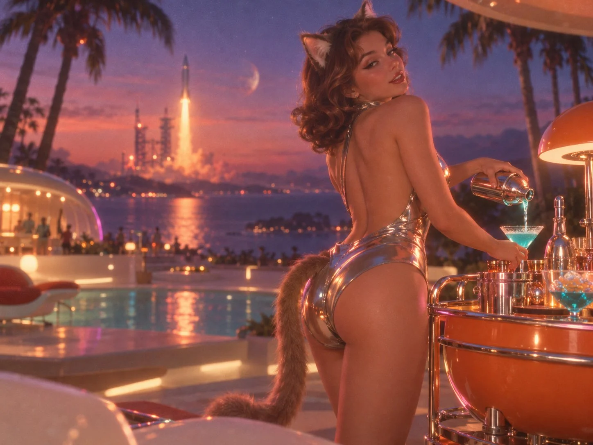

# Space-Age Catgirl Beach-Bar POV Dreamcore

**中文标题：** 太空时代猫娘沙滩吧 POV 梦核  
**ID:** `gi25-x-866` · **Mode:** `generate`  
**Categories:** `general`  
**Tags:** `x-twitter`, `community`, `gpt-image-2.5`, `x-direct`, `zh`



### Space-Age Catgirl Beach-Bar POV Dreamcore

```text
1960年代太空时代（Space Age）度假风情的复古未来主义梦核摄影，采用第一人称主观视角（POV）。画面下缘微露主角所躺的白色流线型沙滩椅扶手一角，视线聚焦于右前方近景：一位身姿妖娆的复古卷发猫娘正侧背对镜头站在流线型太空橙色移动小吧台旁，毛茸猫耳微动；她身穿高光泽液态铬合金大露背紧身衣，随着微倾身姿将镀铬雪克壶中的冰镇青色鸡尾酒缓缓冲入马天尼杯，完美展露出紧致优雅的背部曲线与身后慵懒摇曳的猫尾，液态金属衣料映出迷离的霓虹漫反射。她正越过肩头微微回眸，向躺椅上的观者投来微醺魅惑的目光。

中景是露天甲板边缘几株在晚风中摇曳的热带棕榈树剪影，与前景形成舒适的距离感；远景开阔的深靛蓝与紫罗兰暮色海湾对岸，一座复古未来主义火箭发射架静立天际，一枚银色流线型火箭正拖着柔和的暖琥珀色尾焰缓缓升空。画面彻底摒弃生硬锐利感，内化梦核光学质感：远景发射场与棕榈树处于浅景深柔焦虚化中，化作梦幻的焦外光斑（Bokeh）；火箭的暖金尾焰穿透薄雾，在金属紧身衣边缘与酒杯高光处晕染出柔和的暖红胶片辉光溢出（Halation），全图暗部轻微褪色发灰，覆盖细腻的35mm彩色胶片颗粒噪点。
```

- **Recommended model:** `gpt-image-2.5-sunburst`
- **Settings:** _(defaults)_
- **Source:** [community](https://x.com/alanblogsooooo/status/2110943314312614262) — @alanblogsooooo
- **License note:** Original public X post; quoted with attribution — remix with attribution
- **Notes:** Collected directly from X; original post https://x.com/alanblogsooooo/status/2110943314312614262; post text names GPT Image 2.5; discovered via X search, prompt re-verified against the original X post via api.fxtwitter.com; verified=True
- **Preview:** `previews/gi25-x-866.webp`
