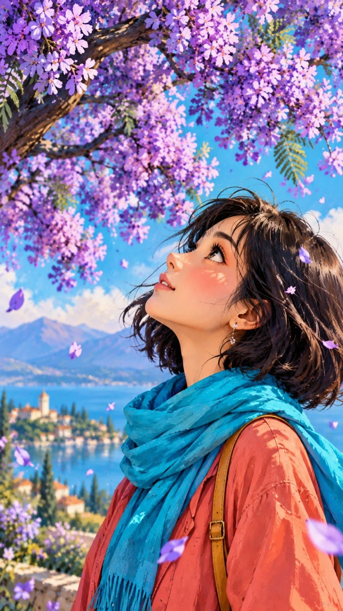

# Storybook Illustrated Woman Looking Up

**中文标题：** 故事书插画风仰望少女  
**ID:** `gi25-x-867` · **Mode:** `generate`  
**Categories:** `general`  
**Tags:** `x-twitter`, `community`, `gpt-image-2.5`, `x-direct`, `en`



### Storybook Illustrated Woman Looking Up

```text
{
  "prompt": "Create a beautiful vertical 9:16 digital painting in a vibrant, expressive storybook illustration style. A young woman with a short dark bob haircut stands in the lower-right portion of the composition, peacefully looking upward at a magnificent flowering jacaranda tree. The enormous dark branches sweep diagonally across the upper half of the image, covered in clusters of vivid violet, electric purple, and magenta blossoms. Tiny purple petals float gently through the air. The woman wears a flowing coral-red coat, a bright turquoise scarf, dark plum leggings, and elegant black ankle boots. A small mustard-yellow shoulder bag adds a warm accent. The background features a rich turquoise-blue sky blending into soft lavender mountains, with subtle painterly textures and a few delicate wildflowers along the ground. Use a bold, highly saturated color palette with striking contrasts between violet flowers, turquoise surroundings, coral clothing, and golden highlights. Artistic hand-painted brushstrokes, delicate ink outlines, textured paper finish, atmospheric depth, beautiful natural lighting, poetic and peaceful mood. The tree canopy fills the upper third and spreads across the frame, while generous open space in the middle emphasizes the woman and creates a balanced composition. Full-body character visible, elegant natural pose, visually rich details, polished high-quality illustration, beautiful color harmony, 9:16 portrait composition.",
  "negative_prompt": "photorealistic, 3D render, dull colors, washed-out palette, blurry details, low resolution, distorted anatomy, extra limbs, extra fingers, malformed hands, duplicate people, oversized head, cropped feet, cut-off body, text, watermark, logo, copied composition, yellow autumn leaves, orange trench coat, plain empty background",
  "aspect_ratio": "9:16",
  "style": "vibrant painterly storybook illustration",
  "quality": "high"
}
```

- **Recommended model:** `gpt-image-2.5-sunburst`
- **Settings:** _(defaults)_
- **Source:** [community](https://x.com/hey_am_cherry/status/2110952509217140779) — @hey_am_cherry
- **License note:** Original public X post; quoted with attribution — remix with attribution
- **Notes:** Collected directly from X; original post https://x.com/hey_am_cherry/status/2110952509217140779; post text names GPT Image 2.5; discovered via X search, prompt re-verified against the original X post via api.fxtwitter.com; verified=True
- **Preview:** `previews/gi25-x-867.webp`
