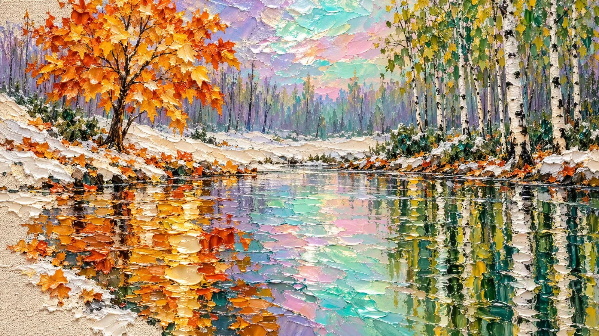

# Impasto Iridescent-Sky Panorama

**中文标题：** 厚涂油画虹彩天空全景  
**ID:** `gi25-x-870` · **Mode:** `generate`  
**Categories:** `general`  
**Tags:** `x-twitter`, `community`, `gpt-image-2.5`, `x-direct`, `en`



### Impasto Iridescent-Sky Panorama

```text
Extremely thick impasto oil painting on rough grainy ground, sculptural palette-knife paint standing up in real three-dimensional petals and slabs, wide 16:9 panoramic composition. Edge to edge, no frame, no border.

SKY: a luminous iridescent sky fills the upper middle, washed in soft pastel lavender, mint green, pale turquoise, blush pink and peach, shimmering like mother-of-pearl and crinkled foil. Behind it, distant slender tree trunks fade into a pale violet and green haze.

LEFT: the hero, one young maple tree in brilliant golden-orange, its leaves raised into thick knife-petals of amber, ochre, burnt orange and pale yellow, each leaf a sculpted curl catching light, thin dark branches rising from a narrow trunk.

RIGHT: a stand of slender birches, white trunks marked with rough black dashes, crowned with small green and yellow leaves in crisp short dabs, rising to the top edge.

MIDDLE: a pale bank of drifted snow and cream ground runs between the trees, cracked into heavy ridges, with low green shrubs and dry orange leaves lying along the waterline.

WATER: the bottom half is a still flooded surface reflecting everything above in broken marbled bands — slabs of gold, amber and white for the maple, long vertical green and white streaks for the birches, and a wide band of iridescent mint, pink and turquoise at the centre. The reflections lie as separate thick paint slabs, each edged with a bright rim.

GROUND: bare areas of unpainted canvas show as pale cream, coarse and grainy, scattering the lower corners and left edge with heavy texture.

PALETTE: golden amber, burnt orange, ivory cream, pale mint, turquoise, blush pink, soft violet, deep green, black. Heavy tactile ridges, glossy thick paint, clean and unmarked.
```

- **Recommended model:** `gpt-image-2.5-sunburst`
- **Settings:** _(defaults)_
- **Source:** [community](https://x.com/churvikv/status/2111082882315755584) — @churvikv
- **License note:** Original public X post; quoted with attribution — remix with attribution
- **Notes:** Collected directly from X; original post https://x.com/churvikv/status/2111082882315755584; post text names GPT Image 2.5; discovered via Bin0754/gpt-image-gallery index, prompt re-verified against the original X post via api.fxtwitter.com; verified=True
- **Preview:** `previews/gi25-x-870.webp`
