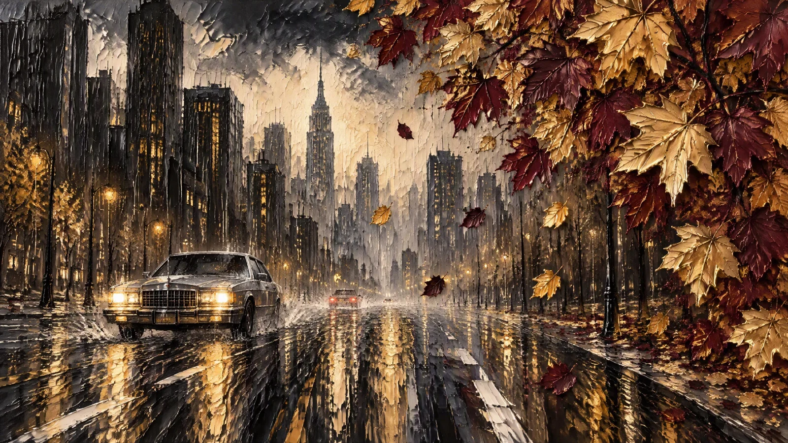

# Impasto Maple-Canopy Rainy Panorama

**中文标题：** 厚涂油画枫叶雨景全景  
**ID:** `gi25-x-872` · **Mode:** `generate`  
**Categories:** `general`  
**Tags:** `x-twitter`, `community`, `gpt-image-2.5`, `x-direct`, `en`



### Impasto Maple-Canopy Rainy Panorama

```text
Textured impasto oil painting on coarse canvas, thick sculptural palette-knife strokes standing in real ridges, wide 16:9 panoramic composition. Edge to edge, no frame and no border.

LEAVES: across the upper right and down the whole right edge hangs a dense canopy of large maple leaves on thin dark branches, each leaf a separate thick knife-sculpted plaque with crisp pointed lobes and raised veins. Colours alternate between brilliant metallic gold and deep burgundy-maroon, some leaves glowing with pale warm highlights, others matte and shadowed. Loose leaves drift down through the middle of the frame.

CITY: the left two-thirds is a wet downtown avenue in heavy rain. Tall dark skyscraper silhouettes rise on the left in near-black vertical slabs with ochre, grey and tan paint dragged across them. Behind them, a pale luminous haze of cream and warm grey light glows between the towers, and a slender spire stands at the centre of the skyline, with softer tower shapes fading into the fog further back.

CAR: low left of centre, a boxy eighties silver-grey sedan drives toward the viewer, headlights switched on and flaring bright warm yellow, chrome grille and bumper catching light, dark windows, black tyres. A second car sits far back in the mist, its red tail lights barely visible.

ROAD: the lower half is wet asphalt rendered in long violent vertical knife-scrapes — black, charcoal, ochre and grey ridges with bold white painted lane lines and a scattering of glowing gold reflections that pool and streak toward the viewer.

SKY: the upper left and top edge is dark charcoal and black, scumbled and scraped with heavy texture, broken by pale cream patches that read as rain-lit cloud.

PALETTE: near-black, charcoal, ochre, warm cream, brilliant gold, burgundy maroon, silver grey. Heavy tactile ridges, matte finish, moody and cinematic, clean and unmarked.
```

- **Recommended model:** `gpt-image-2.5-sunburst`
- **Settings:** _(defaults)_
- **Source:** [community](https://x.com/churvikv/status/2111408437963694264) — @churvikv
- **License note:** Original public X post; quoted with attribution — remix with attribution
- **Notes:** Collected directly from X; original post https://x.com/churvikv/status/2111408437963694264; post text names GPT Image 2.5; discovered via Bin0754/gpt-image-gallery index, prompt re-verified against the original X post via api.fxtwitter.com; verified=True
- **Preview:** `previews/gi25-x-872.webp`
