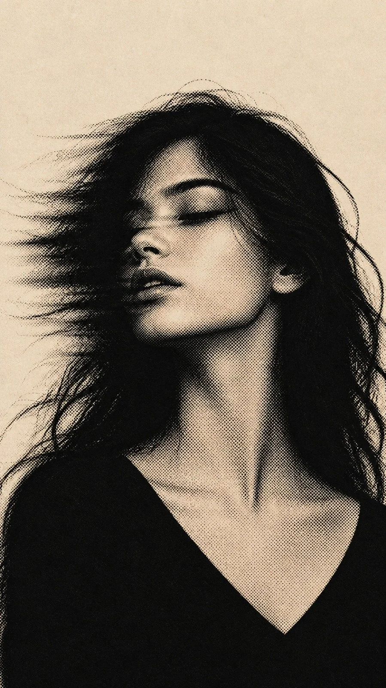

# Monochrome Halftone Windswept Portrait (JSON)

**中文标题：** 黑白网点风吹发人像（JSON）  
**ID:** `gi25-x-873` · **Mode:** `generate`  
**Categories:** `general`  
**Tags:** `x-twitter`, `community`, `gpt-image-2.5`, `x-direct`, `en`



### Monochrome Halftone Windswept Portrait (JSON)

```text
{
  "aspect_ratio": "9:16",
  "prompt": "A beautiful young woman with long, messy black hair blowing dramatically across her face, eyes closed, lips slightly parted, head tilted back, elegant elongated neck, wearing a simple black V-neck top. Chest-up portrait, slightly right of center. Vintage monochrome halftone print art, tiny black ink dots, stippled shading, high contrast, warm ivory textured paper background, deep black shadows, cream highlights, retro editorial photography, moody, dreamy, melancholic, intricate details, sharp facial features, authentic screen-print texture.",
  "negative_prompt": "color, 3D, anime, plastic skin, open eyes, exaggerated expression, deformed face, bad anatomy, extra features, busy background, text, watermark, excessive blur"
}
```

- **Recommended model:** `gpt-image-2.5-sunburst`
- **Settings:** _(defaults)_
- **Source:** [community](https://x.com/hey_am_cherry/status/2111324127378416005) — @hey_am_cherry
- **License note:** Original public X post; quoted with attribution — remix with attribution
- **Notes:** Collected directly from X; original post https://x.com/hey_am_cherry/status/2111324127378416005; post text names GPT Image 2.5; discovered via Bin0754/gpt-image-gallery index, prompt re-verified against the original X post via api.fxtwitter.com; verified=True
- **Preview:** `previews/gi25-x-873.webp`
