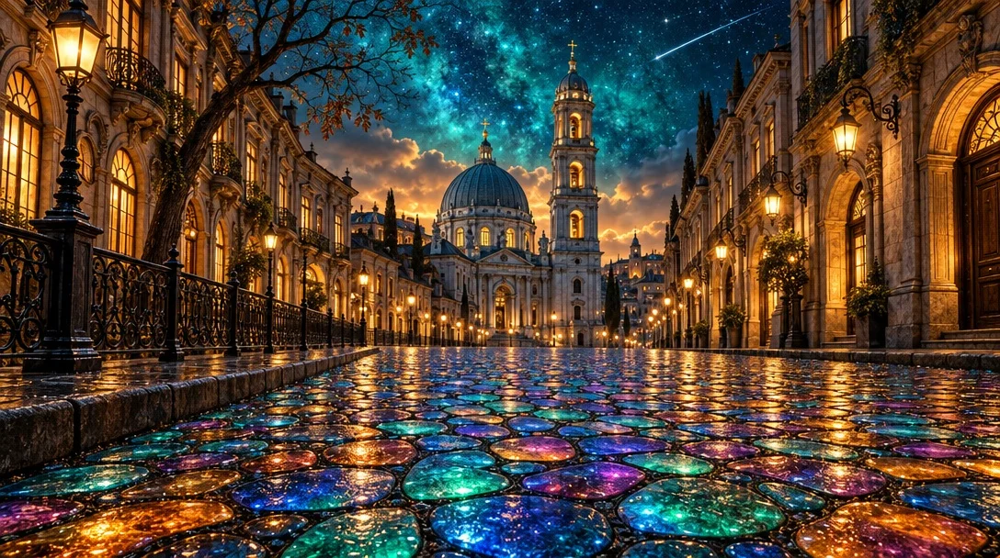

# Glowing Stained-Glass Cobblestone Old-Town Night

**中文标题：** 发光彩窗石板古镇夜街  
**ID:** `gi25-x-876` · **Mode:** `generate`  
**Categories:** `general`  
**Tags:** `x-twitter`, `community`, `gpt-image-2.5`, `x-direct`, `en`



### Glowing Stained-Glass Cobblestone Old-Town Night

```text
Photorealistic magical old-town street at night, wide 16:9 panoramic composition, one-point perspective, cinematic, ultra-detailed. Edge to edge, no frame, no border.
STREET: the entire lower half is a mosaic cobblestone pavement of irregular rounded stones separated by dark joints, split into a central raised walkway with a low kerb on the left. Every stone glows from within like stained glass or opal — saturated turquoise and emerald flowing into cobalt blue, magenta, violet, warm amber and orange, each stone a separate luminous cell with wet cracks and bright glossy reflective highlights.
TOWERS: at the vanishing point, dead centre, stands a grand blue-grey church with a large ribbed dome and a slender arcade, and beside it a tall Baroque bell tower of four stacked tiers with arched openings, a cupola and a gold finial, its windows glowing warm amber from inside. Pale warm streetlamps burn along the facade.
LEFT: a curved row of ornate old-European buildings in warm brown stone with lit arched windows, wrought-iron balconies and carved cornices. A black cast-iron railing runs along the kerb. A dark angular lamppost with a glowing lantern stands at the left edge, and a bare crooked tree with sparse brown leaves rises above the rooftops.
RIGHT: a mirrored row of tall classical facades in the same warm stone, with a row of streetlamps on curved arms marching into the distance, glowing amber, and deep arched doorways lit gold from within.
SKY: the upper third is a deep cosmic teal and turquoise night sky, richly nebulous and swirling, scattered with countless tiny stars. A pale meteor trail streaks diagonally across the upper right. Low warm clouds glow peach and amber behind the towers at the horizon.
PALETTE: turquoise, cobalt, emerald, magenta, violet, warm amber, brown stone, near-black shadow. Sharp focus, glossy wet highlights, high dynamic range, clean and unmarked.
```

- **Recommended model:** `gpt-image-2.5-sunburst`
- **Settings:** _(defaults)_
- **Source:** [community](https://x.com/churvikv/status/2111898318074708289) — @churvikv
- **License note:** Original public X post; quoted with attribution — remix with attribution
- **Notes:** Collected directly from X; original post https://x.com/churvikv/status/2111898318074708289; post text names GPT Image 2.5; discovered via Bin0754/gpt-image-gallery index, prompt re-verified against the original X post via api.fxtwitter.com; verified=True
- **Preview:** `previews/gi25-x-876.webp`
