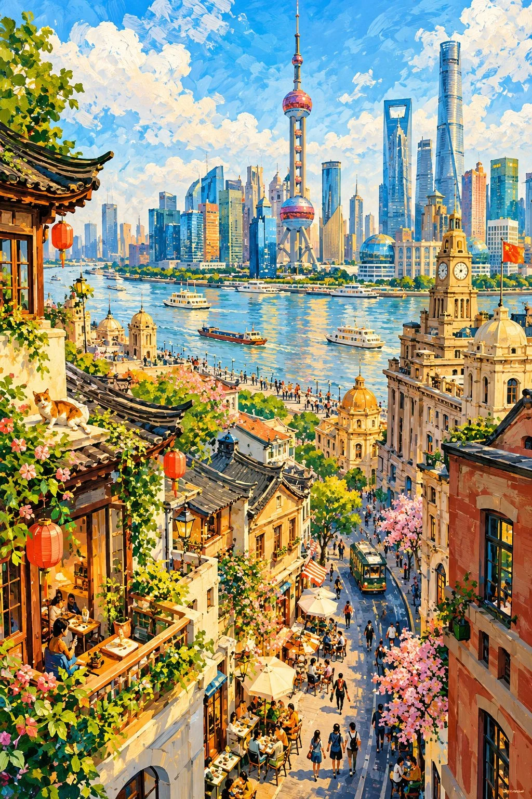

# Whimsical Gouache Storybook Location Illustration

**中文标题：** 奇趣水粉绘本风地点插画  
**ID:** `gi25-x-881` · **Mode:** `generate`  
**Categories:** `general`  
**Tags:** `x-twitter`, `community`, `gpt-image-2.5`, `x-direct`, `en`



### Whimsical Gouache Storybook Location Illustration

```text
Create a distinctive 2:3 vertical hand-painted illustration of [COUNTRY / CITY / LOCATION / SUBJECT], inspired by whimsical contemporary storybook art and lively sunlit gouache.

COMPOSITION:
Feature one recognizable local setting with playfully elongated buildings, crooked rooflines, curved streets, and overlapping architectural forms. Use an expressive elevated viewpoint, dynamic diagonals, and authentic local details. Include a few connected moments of everyday life, quirky characters, and gentle visual humor.

ART STYLE:
Bold opaque gouache, confident brushstrokes, broken edges, dry-brush textures, visible underpainting, and spontaneous hand-painted imperfections. Combine broad color shapes with lively details in foliage, architecture, clothing, and everyday objects.

COLOR & LIGHT:
Luminous sky blue, turquoise, coral, terracotta, buttery yellow, leafy green, and creamy white. Adapt the palette to the destination, with radiant sunlight, fresh cool shadows, and balanced colors.

ATMOSPHERE:
Playful, energetic, warm, and unmistakably handmade. Let expressive people, amusing interactions, and distinctive local details bring the scene to life while keeping architecture dominant.

AVOID:
Photographic realism, generic tourist scenes, repetitive patterns, uniform detailing, excessive texture, glossy digital effects, text, borders, and watermarks.

FORMAT: Full-frame 2:3 vertical composition, collectible illustrated-storybook aesthetic.
```

- **Recommended model:** `gpt-image-2.5-sunburst`
- **Settings:** _(defaults)_
- **Source:** [community](https://x.com/Goodmanprotocol/status/2111039997210186212) — @Goodmanprotocol
- **License note:** Original public X post; quoted with attribution — remix with attribution
- **Notes:** Collected directly from X; original post https://x.com/Goodmanprotocol/status/2111039997210186212; post text names GPT Image 2.5; discovered via Bin0754/gpt-image-gallery index, prompt re-verified against the original X post via api.fxtwitter.com; verified=True
- **Preview:** `previews/gi25-x-881.webp`
