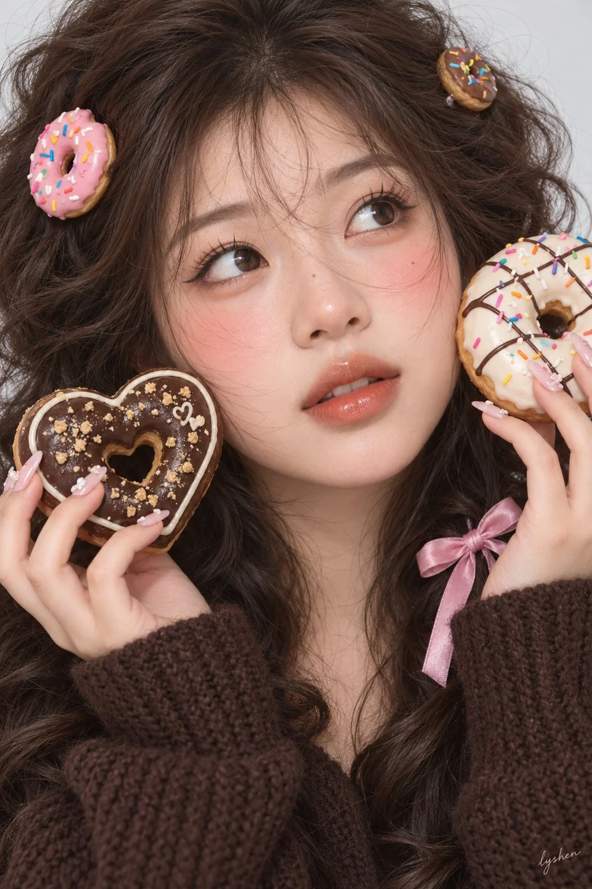

# Donut-Prop Sweet Fashion Portrait

**中文标题：** 甜甜圈道具甜美时尚人像  
**ID:** `gi25-x-886` · **Mode:** `generate`  
**Categories:** `general`  
**Tags:** `x-twitter`, `community`, `gpt-image-2.5`, `x-direct`, `zh`



### Donut-Prop Sweet Fashion Portrait

```text
2:3竖幅，甜甜圈主题的甜美时尚人像写真，取景从头顶至上胸，人物头部占据画面大部分，背景为平滑、自然失焦的浅灰白色。一位年轻成年东亚女性，上身基本朝向镜头，头轻轻向画面左侧倾斜，脸略朝画面右侧，眼睛看向右上方，双唇自然微张，神态带一点好奇与出神。

双手分别抬在两侧下脸颊旁，手指弯曲托住甜甜圈道具，糖霜面朝向镜头：画面左侧是一枚深巧克力色爱心甜甜圈，表面点缀金色碎屑；画面右侧是一枚奶白糖霜圆形甜甜圈，带巧克力交叉淋线和彩色糖针，外缘与部分手指轻微出框。两枚道具围住脸部，中央五官完整露出，浅粉色长甲点缀小巧立体花饰。

深棕色蓬松中长发，轻薄碎刘海，头顶和两侧发束自然扬起，少量细发掠过鼻梁与脸颊；头顶及耳侧点缀米棕、草莓粉甜甜圈造型发饰，垂落发束间系着粉色蝴蝶结。穿巧克力棕宽松罗纹针织衫，长袖口覆盖手腕。

面部轮廓柔和，下颌渐收、下巴圆润，杏眼与自然唇形。暖桃粉底色，面颊和鼻梁有轻柔粉色晕染，睫毛清楚，嘴唇呈水润蜜桃珊瑚色。面部明亮而柔和，鼻下、发丝下与下颌保留浅淡阴影，小范围润泽高光集中在鼻尖和唇部。

整体采用暖奶油与巧克力棕的糖果写真调色，浅灰白背景保持近中性，粉色只作局部点缀。肤面低微对比、过渡柔润，眼睛、合焦发束、针织纹理与糖霜边缘仍可辨，深色头发保留重量和层次。避免塑料肤质、整脸油光、过度锐化、脏噪点以及手指与道具粘连。
```

- **Recommended model:** `gpt-image-2.5-sunburst`
- **Settings:** _(defaults)_
- **Source:** [community](https://x.com/lishishen7i/status/2111442606655963149) — @lishishen7i
- **License note:** Original public X post; quoted with attribution — remix with attribution
- **Notes:** Collected directly from X; prompt posted as the author's reply https://x.com/lishishen7i/status/2111442606655963149 to https://x.com/lishishen7i/status/2111442541400949157, which carries the images and names GPT Image 2.5; discovered via Bin0754/gpt-image-gallery index, prompt re-verified against the original X post via api.fxtwitter.com; verified=True
- **Preview:** `previews/gi25-x-886.webp`
