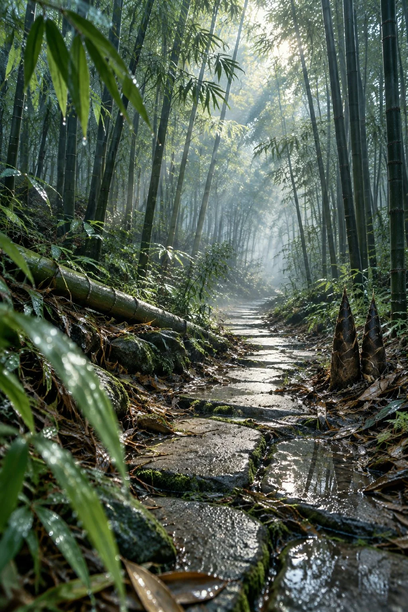

# Misty Jiangnan Bamboo Grove After Rain

**中文标题：** 雨后江南竹林薄雾小径  
**ID:** `gi25-x-892` · **Mode:** `generate`  
**Categories:** `general`  
**Tags:** `x-twitter`, `community`, `gpt-image-2.5`, `x-direct`, `zh`



### Misty Jiangnan Bamboo Grove After Rain

```text
雨后初晴的江南竹林深处，青石小径通幽，misty bamboo grove cinematic photograph.

地点是南方丘陵的毛竹林，刚下过一场透雨，清晨7点左右；空气里悬着未散的薄雾，石径两旁堆着被雨水打落的竹叶，叶尖还挂着水珠。

主体物：一条蜿蜒向前的青石板小径，石板缝隙间冒着翠绿苔藓，石面被雨水浸得发亮、倒映出竹影；石径左侧横卧着半截雨后倒下的青竹，竹节处沁出水渍；右侧竹丛下立着几株雨后刚冒头的竹笋，笋壳还带着泥点。

氛围粒子：低空弥漫着稀薄水雾、晨雾；竹叶上的雨珠偶尔滴落；光柱中漂浮着细微的水汽微粒和浮尘，雨后特有的清新湿润感。

光线：雨后云隙洒下的散射柔光，6500K偏冷的日光；一道斜射的光束穿透竹叶间隙打在石径中段，形成明显的丁达尔光束；竹林深处光线渐暗，近亮远幽的递进。

背景分层：前景是沾着雨滴的近处竹叶（轻微虚化）；中景是青石板小径和光束；远景是层层叠叠的竹干与竹林深处渐隐的雾气，竹干由深绿渐变为灰蓝的雾色。

相机：贴近地面的低机位，24mm广角，竖构图9:16，石径从画面底部斜向延伸至远方消失点，f/8深景深保证竹林纵深清晰；手持拍摄的轻微随意感，画面带film grain颗粒感。

调色：Fujifilm Eterna胶片模拟，青绿与冷灰为主色调，石板反射处带一点暖金高光；冷暖对撞但整体偏清冷；情绪是雨后空山的新寂、幽静深远。

构图：石径对角线引导视线向消失点，三分法布局，画面上方竹叶留白约三分之一，negative space呼吸感。

质量标签：ultra detailed, 8K, photorealistic, cinematic lighting, film still, sharp focus.

负面约束：No oil painting, No anime, No 3D render, No cartoon, No people, No text, No watermark, No oversaturated.
```

- **Recommended model:** `gpt-image-2.5-sunburst`
- **Settings:** _(defaults)_
- **Source:** [community](https://x.com/CandyTravelight/status/2111356537558138947) — @CandyTravelight
- **License note:** Original public X post; quoted with attribution — remix with attribution
- **Notes:** Collected directly from X; original post https://x.com/CandyTravelight/status/2111356537558138947; post text names GPT Image 2.5; discovered via Bin0754/gpt-image-gallery index, prompt re-verified against the original X post via api.fxtwitter.com; verified=True
- **Preview:** `previews/gi25-x-892.webp`
