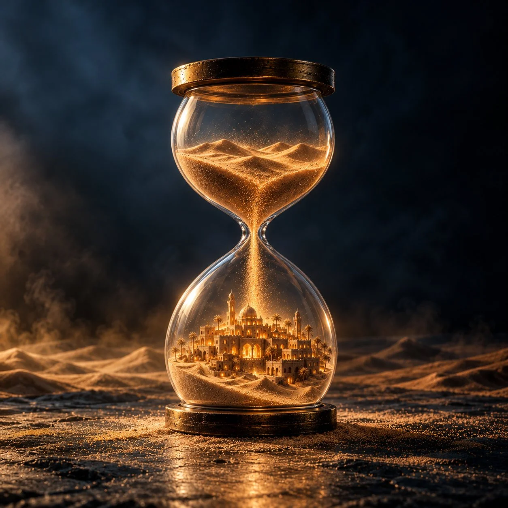

# Desert Hourglass Surreal Editorial Photo

**中文标题：** 沙漠沙漏超现实编辑摄影  
**ID:** `gi25-x-894` · **Mode:** `generate`  
**Categories:** `general`  
**Tags:** `x-twitter`, `community`, `gpt-image-2.5`, `x-direct`, `en`



### Desert Hourglass Surreal Editorial Photo

```text
Create an ultra-premium surreal editorial photograph, square 1:1 aspect ratio, featuring an elegant transparent glass hourglass with aged dark bronze metallic rims, standing alone in a mysterious desert studio environment.
Composition: Wide cinematic shot, zoomed out, with the entire hourglass fully visible and positioned in the center of the frame, occupying approximately 55–60% of the image height. Generous negative space surrounding the hourglass, especially above and on both sides.
Upper Chamber: Filled exclusively with realistic golden desert sand, forming beautiful natural miniature dunes with intricate wind-sculpted textures. No buildings or structures in the upper chamber.
Lower Chamber: An extraordinarily detailed miniature ancient Arabian city emerging organically from golden sand. Beautiful traditional sandstone architecture, illuminated domes, tall minarets, intricate arches, ancient towers, layered buildings, narrow pathways, and scattered palm trees. Every architectural element must remain physically contained inside the glass.
A continuous delicate stream of glowing golden sand falls through the narrow neck of the hourglass into the miniature city below.
Lighting: Warm amber and golden internal illumination radiating from the miniature architecture, contrasting dramatically with a cool, deep midnight-blue and charcoal environment. Cinematic volumetric lighting, realistic glass refractions, subtle reflections, floating dust particles, and soft atmospheric haze.
Environment: Dark desert landscape with subtle rolling dunes in the background, textured sandy ground, delicate scattered golden sand grains, cinematic shadows, and atmospheric depth.
Photography: Ultra-photorealistic, luxury editorial photography, medium-format camera, 85mm lens, f/8, physically accurate glass optics, extreme architectural micro-details, realistic sand particles, sophisticated cinematic color grading, exceptional dynamic range, sharp focal point, 8K quality.
Art Direction: Minimalist surrealism, timeless Arabian heritage, premium museum-quality visual storytelling, extraordinary realism, elegant composition, warm gold versus cool dark blue.
Add a very small, elegant handwritten signature “Ksa8Turky” in the bottom-left corner.
No people, no additional text, no logos, no floating buildings, no structures outside the hourglass, no cropped hourglass, no excessive visual clutter.
Aspect Ratio: 1:1 — Wide Shot — Zoomed Out — Cinematic — Photorealistic.
```

- **Recommended model:** `gpt-image-2.5-sunburst`
- **Settings:** _(defaults)_
- **Source:** [community](https://x.com/ksa8Turky/status/2111374153735385247) — @ksa8Turky
- **License note:** Original public X post; quoted with attribution — remix with attribution
- **Notes:** Collected directly from X; original post https://x.com/ksa8Turky/status/2111374153735385247; post text names GPT Image 2.5; discovered via Bin0754/gpt-image-gallery index, prompt re-verified against the original X post via api.fxtwitter.com; verified=True
- **Preview:** `previews/gi25-x-894.webp`
