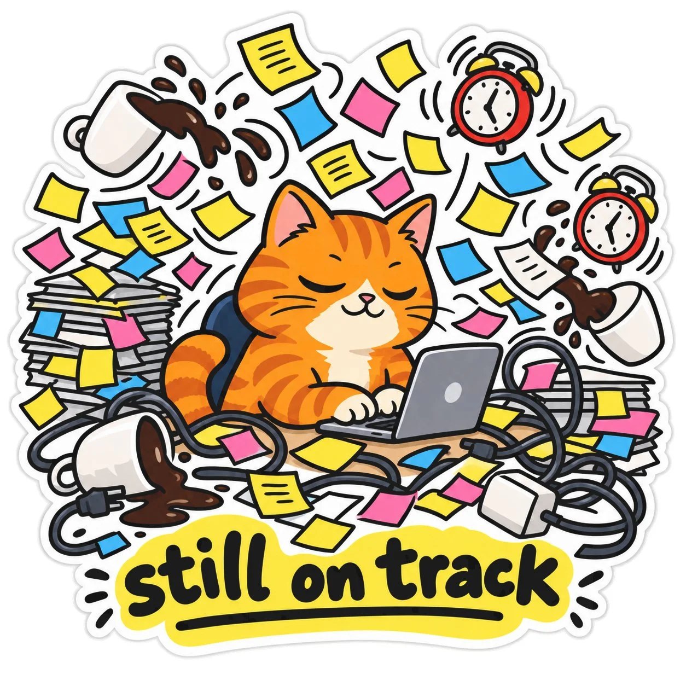

# Calm Office Cat in Chaos Die-Cut Sticker

**中文标题：** 淡定办公猫混乱模切贴纸  
**ID:** `gi25-x-898` · **Mode:** `generate`  
**Categories:** `general`  
**Tags:** `x-twitter`, `community`, `gpt-image-2.5`, `x-direct`, `en`



### Calm Office Cat in Chaos Die-Cut Sticker

```text
Die-cut sticker art of a sleepy orange tabby office cat calmly typing on a tiny laptop while surrounded by an exaggerated storm of flying sticky notes, spilling coffee cups, buzzing alarm clocks, and tangled charger cables, caption: “still on track”, absurd cartoon style, bold saturated colors, thick black outlines, minimal shading, simplified shapes, playful proportions, expressive posture, humorous contrast between calm behavior and surrounding chaos, clean sticker composition, stark white background, no logo, no watermark, no brand names.
```

- **Recommended model:** `gpt-image-2.5-sunburst`
- **Settings:** _(defaults)_
- **Source:** [community](https://x.com/Alyssa4aicreate/status/2111230454468837695) — @Alyssa4aicreate
- **License note:** Original public X post; quoted with attribution — remix with attribution
- **Notes:** Collected directly from X; original post https://x.com/Alyssa4aicreate/status/2111230454468837695; post text names GPT Image 2.5; discovered via Bin0754/gpt-image-gallery index, prompt re-verified against the original X post via api.fxtwitter.com; verified=True; author credits the idea as inspired by @azed_ai
- **Preview:** `previews/gi25-x-898.webp`
