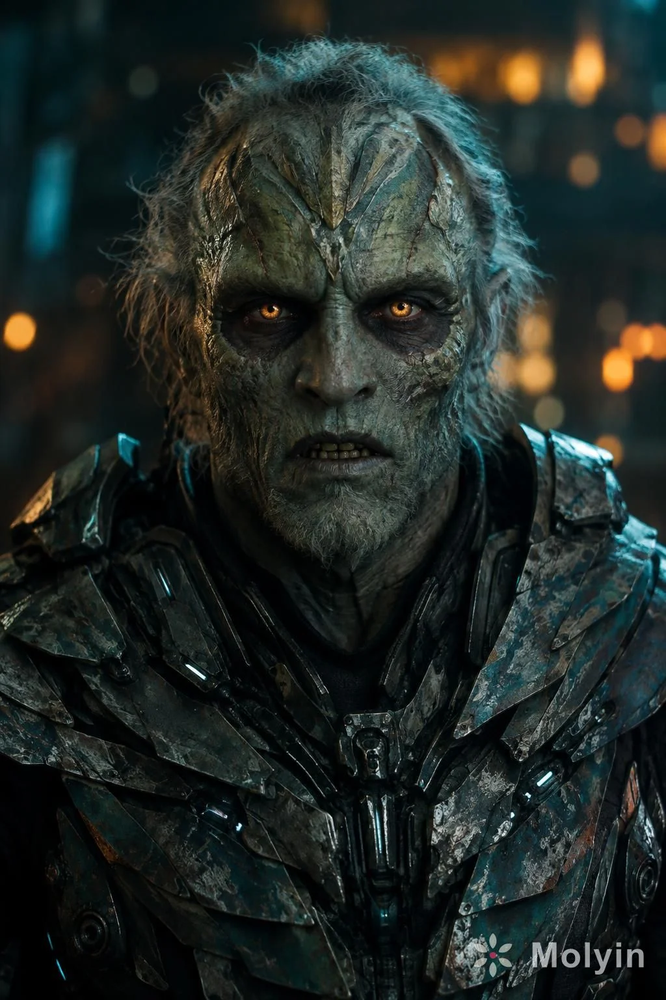

# Ancient Fantasy Creature Cinematic Portrait

**中文标题：** 远古奇幻生物电影感人像  
**ID:** `gi25-x-900` · **Mode:** `generate`  
**Categories:** `general`, `character-consistency`  
**Tags:** `x-twitter`, `community`, `gpt-image-2.5`, `x-direct`, `en`



### Ancient Fantasy Creature Cinematic Portrait

```text
Create an ultra realistic, dark cinematic portrait of an original futuristic fantasy creature with an ancient, weathered appearance and mysterious supernatural presence. The character has textured gray green skin, glowing amber eyes, deep shadows around the eyes, intricate natural skin patterns, fine cracks resembling aged stone, uneven facial textures, and a slightly open mouth revealing aged, irregular teeth. Sparse, messy gray hair surrounds the scalp, with intricate surface details across the forehead and temples.

The character wears original futuristic armor made from hundreds of overlapping, irregular metal plates in dark gunmetal, weathered teal, and charcoal gray. Each plate has unique surface patterns, subtle scratches, worn edges, aged metallic textures, and realistic reflections. Layered shoulder guards, intricate mechanical components, dark fabric, and small cyan blue illuminated elements create a sophisticated science fiction design.

Composition: Vertical 2:3 portrait, centered character, direct gaze toward the camera, head and upper torso visible, broad armored shoulders, symmetrical framing, highly detailed facial features.

Lighting and atmosphere: Cinematic teal and amber color palette, soft teal rim lighting around the head and shoulders, warm golden bokeh lights in the distant background, dramatic but balanced shadows, shallow depth of field, atmospheric nighttime industrial setting.

Photography: Professional cinema camera, 85mm portrait lens, f/1.8 aperture, crisp eye detail, realistic material rendering, physically accurate reflections, natural depth, high dynamic range, premium cinematic color grading.

Overall aesthetic: Photorealistic fantasy science fiction character design, sophisticated practical creature makeup, intricate original armor craftsmanship, realistic textures, atmospheric cinematic photography, exceptional detail, 8K quality.

No text, no logos, no watermark, no cartoon styling, no exaggerated proportions. The final image should look like a professionally photographed original character from a high budget science fiction film.
```

- **Recommended model:** `gpt-image-2.5-sunburst`
- **Settings:** _(defaults)_
- **Source:** [community](https://x.com/molyin_com/status/2111423072544911665) — @molyin_com
- **License note:** Original public X post; quoted with attribution — remix with attribution
- **Notes:** Collected directly from X; prompt posted as the author's reply https://x.com/molyin_com/status/2111423072544911665 to https://x.com/molyin_com/status/2111423008288190955, which carries the images and names GPT Image 2.5; discovered via Bin0754/gpt-image-gallery index, prompt re-verified against the original X post via api.fxtwitter.com; verified=True
- **Preview:** `previews/gi25-x-900.webp`
