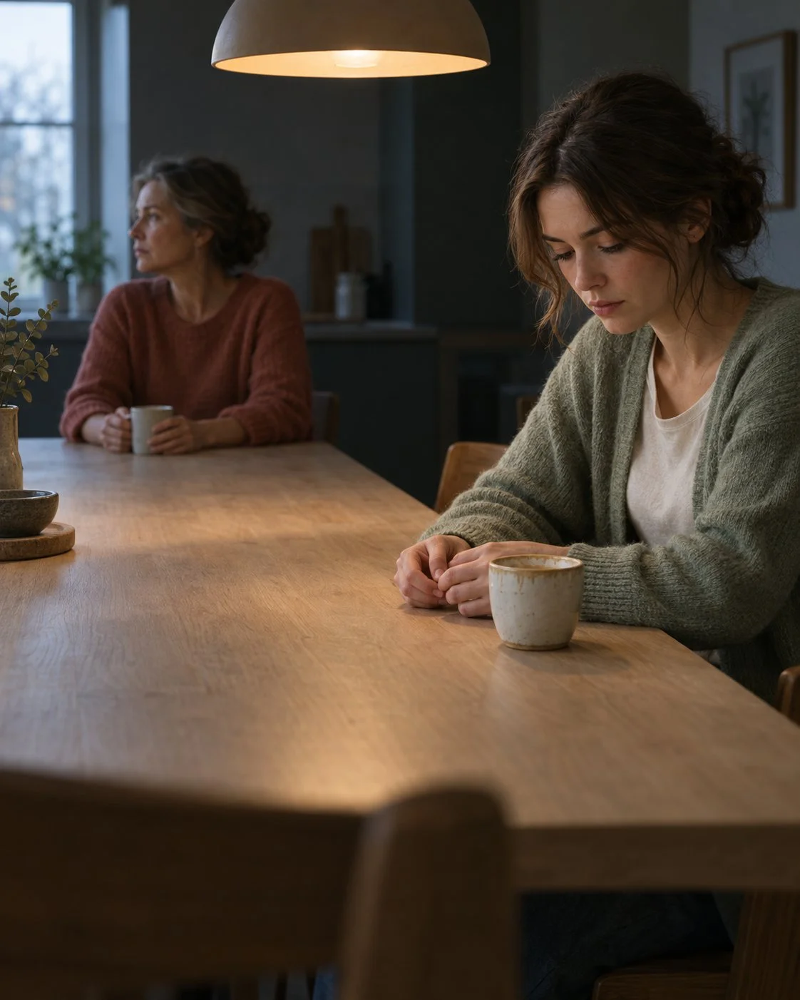

# Mother-Daughter Distance Brunch Table Still

**中文标题：** 母女疏离早午餐长桌剧照  
**ID:** `gi25-x-901` · **Mode:** `generate`  
**Categories:** `general`  
**Tags:** `x-twitter`, `community`, `gpt-image-2.5`, `x-direct`, `en`



### Mother-Daughter Distance Brunch Table Still

```text
Wide two-shot from seated eye height, natural 40mm perspective. An adult daughter sits closer to camera on the right third; her mother sits deeper frame-left at the far end of a long pale oak brunch table. The empty table forms a strong diagonal leading line between them, with large quiet space separating their bodies. Neither makes eye contact: the daughter looks down at her hands resting near a half-finished latte while the mother looks past her toward a soft morning kitchen window.
A warm pendant lamp above the center of the table motivates soft directional light across both characters; the daughter is slightly more exposed while the mother falls into deeper shadow. Cool morning window ambience separates the darker background.
A blurred chair edge crosses the extreme foreground, creating three clear depth planes. Keep the daughter's face as the first point of attention, the mother second, and remove bright background distractions.
Wardrobe: daughter in soft sage cardigan over ivory tee; mother in muted terracotta knit. Natural skin and fabric texture, restrained contrast, realistic exposure, photorealistic editorial still, vertical 4:5, no text, no logo, no watermark.
```

- **Recommended model:** `gpt-image-2.5-sunburst`
- **Settings:** _(defaults)_
- **Source:** [community](https://x.com/Alyssa4aicreate/status/2111561771420975174) — @Alyssa4aicreate
- **License note:** Original public X post; quoted with attribution — remix with attribution
- **Notes:** Collected directly from X; original post https://x.com/Alyssa4aicreate/status/2111561771420975174; post text names GPT Image 2.5; discovered via Bin0754/gpt-image-gallery index, prompt re-verified against the original X post via api.fxtwitter.com; verified=True; author credits the idea as inspired by @beginnersblog1
- **Preview:** `previews/gi25-x-901.webp`
