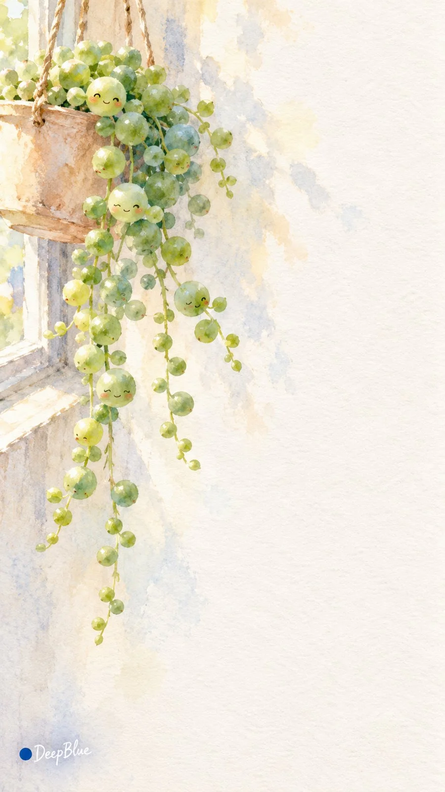

# Healing Succulent Wet-Pastel Anthropomorphic Set

**中文标题：** 治愈系多肉湿粉彩拟人  
**ID:** `gi25-x-902` · **Mode:** `generate`  
**Categories:** `general`  
**Tags:** `x-twitter`, `community`, `gpt-image-2.5`, `x-direct`, `zh`



### Healing Succulent Wet-Pastel Anthropomorphic Set

```text
主题：治愈系多肉植物 × 湿润粉彩画 × 萌系拟人化 × 艺术留白

每张独立选择一种不同的真实多肉品种，探索差异鲜明的叶片形态与自然生长结构。以植物本体为主角，通过克制的微表情与轻微姿态赋予温暖情绪。

采用湿润粉彩手绘技法，色粉在真实棉质画纸上自然溶散、晕染与沉积，形成柔和的色彩交融、不规则湿润边缘与清晰可感的纸张纤维肌理。局部保留粉彩颗粒、手工擦抹痕迹与自然的不完美。

遵循少即是多的艺术构图，以大面积自然画纸、轻淡色彩与自由晕染形成舒适留白。背景通过少量湿润笔触暗示环境，营造安静、含蓄、富有生命力的治愈氛围。

在画面合适的留白位置，以柔和可爱的手写字体标注该多肉植物的真实中文名称，文字清晰自然，与整体色彩和手绘质感协调。

每张重新独立抽卡，自由探索不同多肉品种、情绪、姿态、场景、视角、构图与光线。场景涵盖安静生活空间、自然环境与微型童话世界。同批不重复多肉品种、主要场景与构图结构，保持鲜明视觉差异。

9:16竖版。左下签名：深蓝色实心圆点在前，白色手写体「DeepBlue」在后。

n=4，每张独立生成一张完整图片，分别输出，不拼图。
```

- **Recommended model:** `gpt-image-2.5-sunburst`
- **Settings:** _(defaults)_
- **Source:** [community](https://x.com/DeepBlueX0/status/2111372818248282526) — @DeepBlueX0
- **License note:** Original public X post; quoted with attribution — remix with attribution
- **Notes:** Collected directly from X; original post https://x.com/DeepBlueX0/status/2111372818248282526; post text names GPT Image 2.5; discovered via Bin0754/gpt-image-gallery index, prompt re-verified against the original X post via api.fxtwitter.com; verified=True
- **Preview:** `previews/gi25-x-902.webp`
