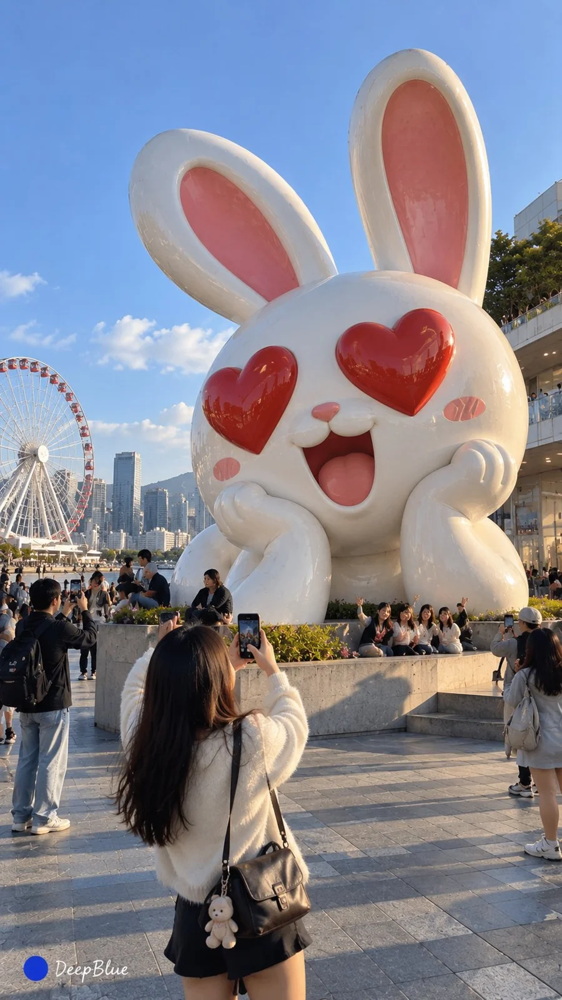

# Emoji Landmark Sculpture Tourist Snapshots

**中文标题：** Emoji 城市地标雕塑游客随拍  
**ID:** `gi25-x-903` · **Mode:** `generate`  
**Categories:** `general`  
**Tags:** `x-twitter`, `community`, `gpt-image-2.5`, `x-direct`, `zh`



### Emoji Landmark Sculpture Tourist Snapshots

```text
主题：Emoji × 城市地标雕塑 × 公共艺术 × 真实游客摄影

将不同 Emoji 表情或符号转化为具有地标辨识度的实体公共艺术雕塑。

每张独立选择一种不同 Emoji，根据其造型、情绪与象征含义，匹配不同类型的公园、景区、商场、广场或其他公共空间。

提取 Emoji 的经典视觉特征，设计具有原创性与艺术感的三维雕塑。根据主题自由选择青铜、不锈钢、石材、彩绘玻璃钢等真实工艺，合理设计雕塑形态、尺度、姿态与安装结构。

雕塑与所在地的建筑、景观及公共设施自然融合，具有永久性城市地标的真实存在感。游客可自然经过、驻足、互动或合影，呈现真实空间尺度与生活氛围。

iPhone 原相机游客随手抓拍，真实材质、自然光线与现场感。自由探索拍摄距离、机位、构图与光线。

9:16竖版，左下签名：深蓝色实心圆点在前，白色手写体「DeepBlue」在后。

n=4，生成4张独立单图。每张重新选择不同 Emoji、雕塑设计、材质、场景背景、人物互动与拍摄视角，分别输出，不拼图。
```

- **Recommended model:** `gpt-image-2.5-sunburst`
- **Settings:** _(defaults)_
- **Source:** [community](https://x.com/DeepBlueX0/status/2111299540863037848) — @DeepBlueX0
- **License note:** Original public X post; quoted with attribution — remix with attribution
- **Notes:** Collected directly from X; original post https://x.com/DeepBlueX0/status/2111299540863037848; post text names GPT Image 2.5; discovered via Bin0754/gpt-image-gallery index, prompt re-verified against the original X post via api.fxtwitter.com; verified=True
- **Preview:** `previews/gi25-x-903.webp`
