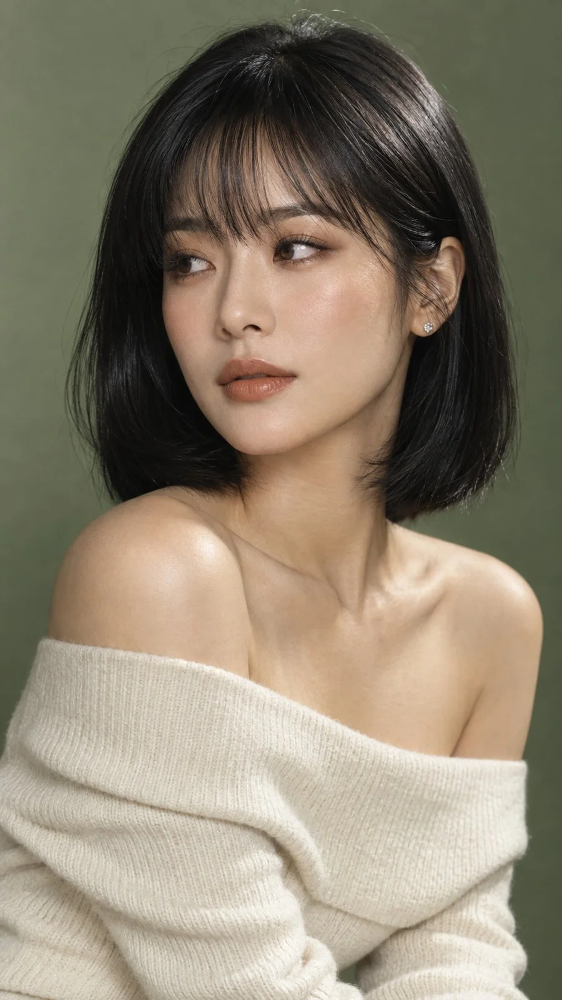

# Sage-Green Studio Bob Beauty Portrait

**中文标题：** 鼠尾草绿棚拍波波头美妆人像  
**ID:** `gi25-x-906` · **Mode:** `generate`  
**Categories:** `general`  
**Tags:** `x-twitter`, `community`, `gpt-image-2.5`, `x-direct`, `en`



### Sage-Green Studio Bob Beauty Portrait

```text
A high-fashion cinematic beauty portrait of an elegant adult East Asian woman against a soft sage-green studio background. She has sleek glossy jet-black shoulder-length bob hair with soft wispy blunt bangs, natural realistic skin texture, delicate facial features, subtle contouring, soft taupe-brown eye makeup, defined lashes, and warm honey-beige lipstick with a slightly satin finish. She wears an elegant cream off-shoulder knit top and a tiny sparkling silver stud earring.

Seated three-quarter portrait, head gently turned away from camera, calm contemplative gaze toward frame-left (not looking at camera), lips softly closed. Soft directional studio lighting from camera-right, subtle warm highlights, gentle shadows, luxurious editorial beauty campaign aesthetic, quiet sophisticated mood, ultra-photorealistic, detailed pores and hair strands, professional fashion photography, shallow depth of field, 85mm lens, high-end beauty magazine quality, clean composition, no text, no logo, no watermark, vertical 9:16.
```

- **Recommended model:** `gpt-image-2.5-sunburst`
- **Settings:** _(defaults)_
- **Source:** [community](https://x.com/Alyssa4aicreate/status/2111923469688390069) — @Alyssa4aicreate
- **License note:** Original public X post; quoted with attribution — remix with attribution
- **Notes:** Collected directly from X; original post https://x.com/Alyssa4aicreate/status/2111923469688390069; post text names GPT Image 2.5; discovered via Bin0754/gpt-image-gallery index, prompt re-verified against the original X post via api.fxtwitter.com; verified=True; author credits the idea as inspired by @MissDelulu9
- **Preview:** `previews/gi25-x-906.webp`
