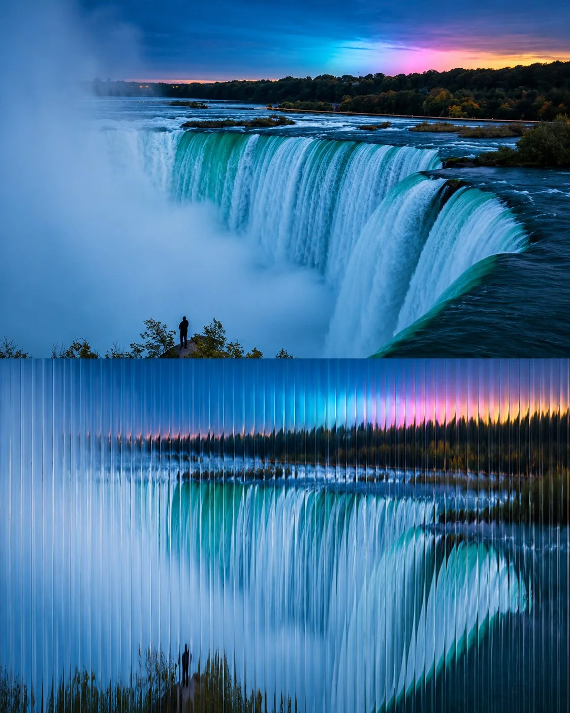

# Photo + Ribbed-Glass Refraction Diptych

**中文标题：** 照片+棱纹玻璃折射上下双联  
**ID:** `gi25-x-914` · **Mode:** `generate`  
**Categories:** `general`  
**Tags:** `x-twitter`, `community`, `gpt-image-2.5`, `x-direct`, `en`



### Photo + Ribbed-Glass Refraction Diptych

```text
Create a cinematic 4:5 vertical photographic diptych using [LOCATION / DESTINATION / SUBJECT] as the scene.

COMPOSITION:
Divide the image into two equal horizontal halves.

TOP HALF — ORIGINAL PHOTOGRAPH:
Show an authentic, beautifully composed photograph with natural lighting, realistic details, atmospheric depth, and refined editorial color grading. Preserve the destination’s recognizable features and genuine photographic appearance.

BOTTOM HALF — RIBBED GLASS TRANSFORMATION:
Recreate the same scene through vertically fluted, translucent glass, as though the original photograph is viewed through a textured architectural glass panel. The closely spaced vertical ridges refract and stretch the buildings, trees, water, lights, and reflections into elegant elongated patterns. Preserve the original scene’s overall composition and recognizable silhouettes while creating a soft, mesmerizing optical distortion.

LIGHT & TEXTURE:
Use natural highlights, subtle reflections, realistic glass refraction, delicate vertical lines, and atmospheric blur. Adapt the lighting and colors to the scene, from lush forest greens to warm sunset oranges or cool coastal blues.

ART DIRECTION:
Minimalist fine-art photography, sophisticated editorial aesthetics, tactile glass texture, poetic visual storytelling, and seamless visual continuity between both halves. Add tiny, understated editorial typography only if desired.

Avoid excessive distortion, artificial neon colors, heavy blur, random patterns, unrelated elements, borders, and watermarks.

FORMAT: Vertical 4:5, precise 50/50 horizontal split, high resolution.
```

- **Recommended model:** `gpt-image-2.5-sunburst`
- **Settings:** _(defaults)_
- **Source:** [community](https://x.com/Goodmanprotocol/status/2112233324760686617) — @Goodmanprotocol
- **License note:** Original public X post; quoted with attribution — remix with attribution
- **Notes:** Collected directly from X; original post https://x.com/Goodmanprotocol/status/2112233324760686617; post text names GPT Image 2.5; discovered via X search, prompt re-verified against the original X post via api.fxtwitter.com; verified=True
- **Preview:** `previews/gi25-x-914.webp`
