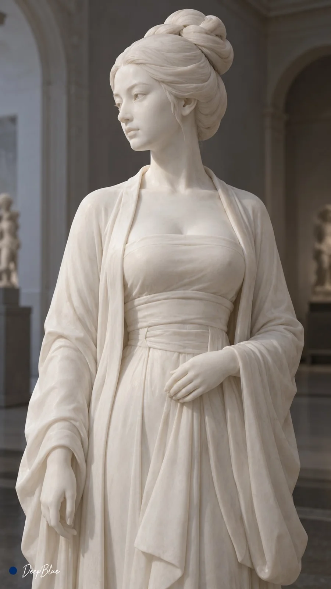

# White Marble Song-Dynasty Hanfu Statue Series

**中文标题：** 白色大理石宋制汉服雕像系列  
**ID:** `gi25-x-928` · **Mode:** `generate`  
**Categories:** `general`  
**Tags:** `x-twitter`, `community`, `gpt-image-2.5`, `x-direct`, `zh`



### White Marble Song-Dynasty Hanfu Statue Series

```text
主题：白色大理石宋制汉服雕像 × 真实雕刻工艺 × 轻盈薄纱 × 随机抽卡

每张独立探索一尊成年女性雕像，沙漏型身材，腰线纤细，上身与髋部曲线饱满，比例自然。自由变化容貌、发式、神态与姿态。

统一穿着宋制褙子、抹胸与长裙，形制清楚，层次简洁。褙子承托于双肩，对襟直领自然垂落，穿着关系协调。

人物与衣物由同一块细粒白色大理石雕成，石纹极淡。遵循真实减材雕刻工艺，以完整体块和宽缓体面塑形，细部保留合理厚度，悬伸部分具有可靠支撑。肌肤区域平整温润，以柔和起伏和适度磨光表现肉感。

头发以平滑、连贯的体块塑造，仅留少量宽浅刻槽，发髻与鬓发贴合主体。眉弓暗示眉部，眼睑简洁，眼球平滑留白，省略毛发丝缕、睫毛与瞳孔细节。手指并拢，以浅槽区分。

汉服素面，以大面积舒展石面和少量宽缓主褶表现垂坠。肩臂局部轻贴形体，暗示薄纱的轻盈；胸腰与裙装保留自然松量，叠层厚实，衣缘圆润。石材保持乳白、不透明。

真实雕塑摄影，柔和侧光。以局部取景展示面部、肩颈、衣领、胸腰、手部、袖口或腰髋，保留必要的结构关联。

9:16竖版，n=6。四张局部特写、一张半身、一张全身，分别独立出图，不拼图。每张变化人物、姿态、空间、机位、取景重点与主褶走势，避免重复。

左下签名：深蓝色实心圆点在前，白色手写体「DeepBlue」在后。
```

- **Recommended model:** `gpt-image-2.5-sunburst`
- **Settings:** _(defaults)_
- **Source:** [community](https://x.com/DeepBlueX0/status/2112048234936049833) — @DeepBlueX0
- **License note:** Original public X post; quoted with attribution — remix with attribution
- **Notes:** Collected directly from X; original post https://x.com/DeepBlueX0/status/2112048234936049833; post text names GPT Image 2.5; discovered via X search, prompt re-verified against the original X post via api.fxtwitter.com; verified=True; the author posted this prompt as a reply under their own image thread https://x.com/DeepBlueX0/status/2112048220578918684
- **Preview:** `previews/gi25-x-928.webp`
