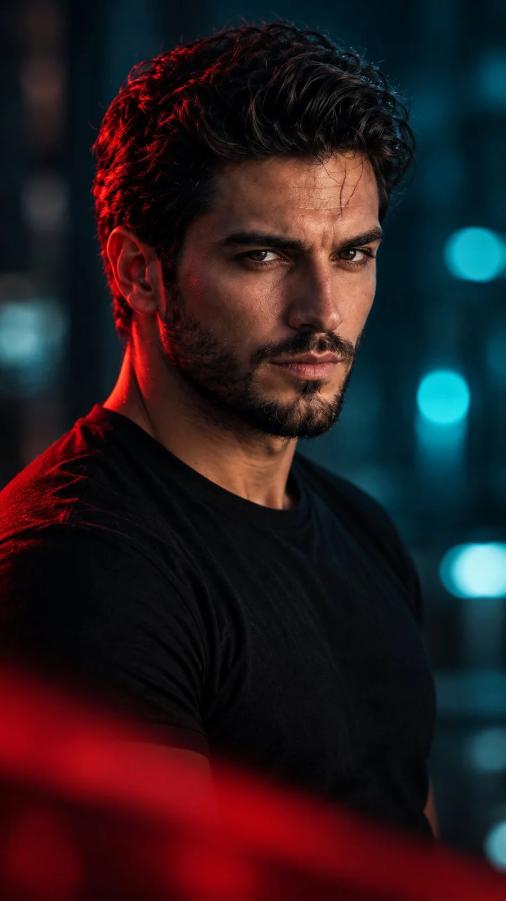

# Red Rim-Light Cinematic Male Portrait

**中文标题：** 红色轮廓光电影感男性人像  
**ID:** `gi25-x-930` · **Mode:** `generate`  
**Categories:** `general`  
**Tags:** `x-twitter`, `community`, `gpt-image-2.5`, `x-direct`, `en`



### Red Rim-Light Cinematic Male Portrait

```text
Ultra-realistic cinematic portrait of a handsome young adult man with thick, voluminous black hair styled upward and backward, a well-groomed full black beard and mustache, strong eyebrows, deep dark eyes, and a sharp masculine jawline. He wears a simple black crew-neck T-shirt and looks directly at the camera with a calm, serious, confident expression. A subtle horizontal scar is visible on his forehead.

Lighting: Dramatic cinematic split lighting with a vivid red rim light illuminating the left side of his hair, ear, beard, and shoulder, contrasted with cool teal and blue ambient lighting in the background. Soft, directional key light highlights the facial texture, natural skin pores, and detailed beard.

Composition: Vertical 9:16 portrait, close-up to medium close-up framing, three-quarter body angle with the face turned toward the camera, subject positioned centrally, shallow depth of field, dark blurred urban or studio background with teal bokeh lights. A soft, out-of-focus red foreground element partially covers the lower portion of the frame, creating cinematic depth.

Photography style: High-end professional portrait photography, Hollywood thriller aesthetic, moody atmosphere, dramatic color grading, deep blacks, rich crimson highlights, cool cyan shadows, realistic skin texture, sharp focus on the eyes, 85mm portrait lens, f/1.8, HDR, photorealistic, 8K detail, natural facial proportions, premium editorial photography.

Negative prompt: cartoon, anime, illustration, CGI, plastic skin, excessive skin smoothing, blurry face, distorted eyes, asymmetrical facial features, deformed hands, oversaturated colors, flat lighting, low resolution, watermark, text, logo.
```

- **Recommended model:** `gpt-image-2.5-sunburst`
- **Settings:** _(defaults)_
- **Source:** [community](https://x.com/iamsofiaijaz/status/2112026489046945941) — @iamsofiaijaz
- **License note:** Original public X post; quoted with attribution — remix with attribution
- **Notes:** Collected directly from X; original post https://x.com/iamsofiaijaz/status/2112026489046945941; post text names GPT Image 2.5; discovered via X search, prompt re-verified against the original X post via api.fxtwitter.com; verified=True
- **Preview:** `previews/gi25-x-930.webp`
