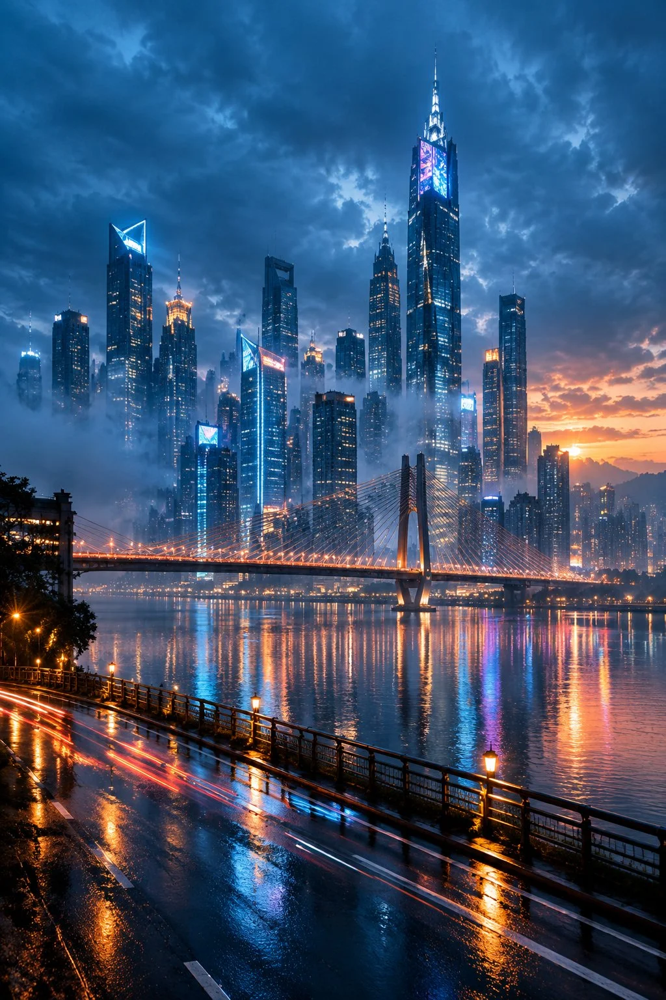

# Rain-Soaked Future City Skyline at Blue Hour

**中文标题：** 雨后蓝调时刻未来都市天际线  
**ID:** `gi25-x-933` · **Mode:** `generate`  
**Categories:** `general`  
**Tags:** `x-twitter`, `community`, `gpt-image-2.5`, `x-direct`, `en`



### Rain-Soaked Future City Skyline at Blue Hour

```text
未来科幻都市天际线，傍晚蓝调时刻，刚下过雨的城市，湿润空气里飘着薄雾。
Environment: mega city downtown after rain, dusk blue hour, overcast sky with a crack of amber sunset on the horizon. 超高层摩天楼群从雾气中拔地而起：玻璃幕墙反射着城市灯光，顶端有霓虹广告牌轮廓，一座斜拉桥横跨画面下方的江面，两岸灯带如河流般蔓延。
Atmosphere: thin rain mist, volumetric light shafts, tiny glowing window lights scattered across towers, light trails on wet asphalt foreground.
Lighting: 混合光源——冷蓝色天光为主，暖橙色街灯与霓虹点缀，形成蓝橙对撞，wet reflection on river doubling the city lights, subtle glow haze.
Camera: low-angle, 24mm wide angle, deep depth of field f/8, slight upward tilt, hand-held feel, anamorphic lens flare.
Color: teal-and-orange cinematic grade, Eastmancolor film stock, fine film grain, high contrast highlights.
Composition: rule of thirds, skyline occupies upper two-thirds, negative space in lower mist, leading lines of the bridge guiding the eye.
Quality: ultra detailed, 8k, photorealistic, sharp architecture, clean geometry.
No oil painting, No anime, No 3D render look, No deformed structures, No text, No watermark, No people.
```

- **Recommended model:** `gpt-image-2.5-sunburst`
- **Settings:** _(defaults)_
- **Source:** [community](https://x.com/CandyTravelight/status/2111978698954129554) — @CandyTravelight
- **License note:** Original public X post; quoted with attribution — remix with attribution
- **Notes:** Collected directly from X; original post https://x.com/CandyTravelight/status/2111978698954129554; post text names GPT Image 2.5; discovered via X search, prompt re-verified against the original X post via api.fxtwitter.com; verified=True; original post compares GPT-image-2.5 (image 1) with Nano Banana 2 and Grok Imagine 2
- **Preview:** `previews/gi25-x-933.webp`
