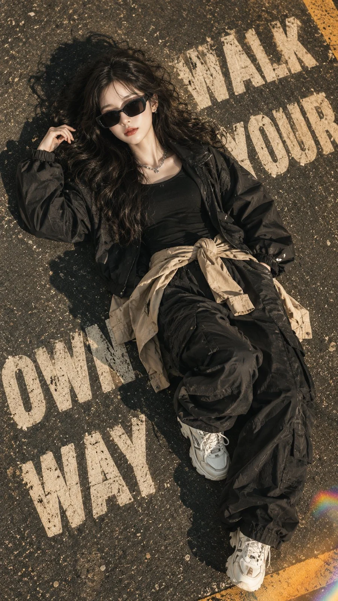

# Overhead Streetwear Asphalt Typography Portrait (JSON)

**中文标题：** 俯拍街头潮服柏油路大字人像（JSON）  
**ID:** `gi25-x-935` · **Mode:** `generate`  
**Categories:** `general`, `poster-typography`  
**Tags:** `x-twitter`, `community`, `gpt-image-2.5`, `x-direct`, `en`



### Overhead Streetwear Asphalt Typography Portrait (JSON)

```text
{
  "prompt": "Create an ultra-realistic, cinematic overhead streetwear fashion portrait of a stylish young adult woman lying diagonally on a dark urban asphalt road. The camera is positioned directly above her, capturing her full body in a dramatic top-down composition. She has voluminous, messy, naturally wavy black hair falling around her face, glossy nude-pink lips, and oversized futuristic black angular sunglasses. Her expression is relaxed, confident, and effortlessly fashionable. She wears an oversized black streetwear jacket layered over a dark top, loose black cargo-style pants, and a beige or tan jacket casually tied around her waist. She wears chunky white sneakers with subtle gray details and metallic accessories, including a silver chain necklace and small earrings. Her pose is casual, with one arm bent near her upper body and her legs positioned naturally on the pavement. The asphalt features large, bold, off-white painted typography reading 'WALK YOUR OWN WAY', arranged across the road around her body. Include realistic road texture, tiny pavement imperfections, scattered dust particles, and a long, sharply defined shadow extending beside her. Warm golden-hour sunlight creates dramatic highlights on her face, hair, sunglasses, sneakers, and clothing. Add subtle film grain, a vintage analog photography aesthetic, cinematic contrast, muted olive and beige tones, soft amber highlights, deep blacks, and a shallow atmospheric depth effect. Include a subtle rainbow-colored lens flare near the bottom-right corner. The image should resemble a premium fashion editorial photographed with a professional camera, with highly detailed fabric textures, realistic skin, natural anatomy, accurate shadows, and crisp subject details.",
  "style": {
    "photography": "cinematic streetwear editorial",
    "realism": "ultra-photorealistic",
    "camera_angle": "direct overhead top-down shot",
    "lighting": "warm golden-hour sunlight",
    "color_grading": "muted olive, warm beige, amber highlights, deep blacks",
    "texture": "subtle film grain and realistic asphalt",
    "mood": "edgy, confident, relaxed, fashionable",
    "lens_effects": "subtle rainbow lens flare and natural shadows"
  },
  "composition": {
    "orientation": "vertical portrait",
    "aspect_ratio": "9:16",
    "subject_position": "diagonal across the center",
    "framing": "full-body overhead composition",
    "background": "dark textured urban pavement",
    "typography": "large off-white road lettering reading WALK YOUR OWN WAY",
    "depth": "sharp subject with subtle cinematic atmospheric softness"
  },
  "negative_prompt": "low resolution, cartoon, anime, illustration, CGI, plastic skin, blurry face, distorted anatomy, extra fingers, extra limbs, malformed hands, unrealistic hair, incorrect sunglasses, poorly rendered sneakers, oversaturated colors, harsh artificial lighting, flat shadows, excessive sharpening, watermark, social media interface, borders, unwanted text, misspelled typography"
}
```

- **Recommended model:** `gpt-image-2.5-sunburst`
- **Settings:** _(defaults)_
- **Source:** [community](https://x.com/HaniaAi12/status/2111617182174208477) — @HaniaAi12
- **License note:** Original public X post; quoted with attribution — remix with attribution
- **Notes:** Collected directly from X; original post https://x.com/HaniaAi12/status/2111617182174208477; post text names GPT Image 2.5; discovered via X search, prompt re-verified against the original X post via api.fxtwitter.com; verified=True
- **Preview:** `previews/gi25-x-935.webp`
