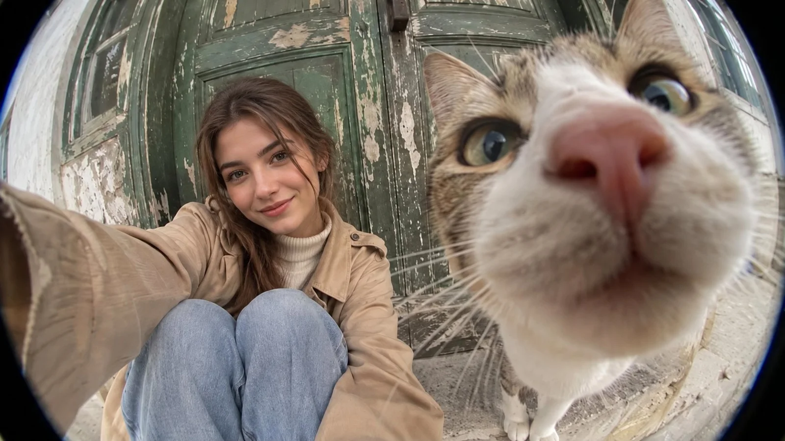

# Fisheye Doorstep Selfie with Tabby Cat (JSON)

**中文标题：** 鱼眼门阶自拍与虎斑猫（JSON）  
**ID:** `gi25-x-938` · **Mode:** `edit`  
**Categories:** `general`, `character-consistency`  
**Tags:** `x-twitter`, `community`, `gpt-image-2.5`, `x-direct`, `en`



### Fisheye Doorstep Selfie with Tabby Cat (JSON)

```text
{
  "generation_settings": {
    "type": "photorealistic lifestyle photograph",
    "aspect_ratio": "3:2",
    "resolution": "high detail",
    "visual_style": "candid travel photography, natural realism",
    "camera_type": "ultra-wide fisheye lens",
    "lens": "8mm fisheye",
    "image_quality": "highly detailed, realistic textures, natural skin tones"
  },
  "scene": {
    "location": "outside an old rustic building",
    "background": {
      "description": "large, aged dark forest-green wooden double door with heavily peeling paint, exposed cream-colored wood, scratches, cracks, weathering and distressed vintage texture",
      "architecture": "old European-style doorway with worn stone steps and weathered masonry",
      "colors": [
        "muted forest green",
        "aged cream",
        "weathered gray stone"
      ]
    },
    "lighting": {
      "type": "soft natural daylight",
      "direction": "diffused outdoor ambient light",
      "shadows": "soft, realistic shadows",
      "mood": "casual, intimate, playful"
    }
  },
  "subject": {
    "woman": {
      "identity": "use the user-provided reference image if available; otherwise generate a naturally beautiful young adult woman",
      "appearance": {
        "hair": "long, naturally tousled chestnut-brown hair with loose strands framing the face",
        "face": "natural facial proportions, expressive brown eyes, subtle eyebrows, soft natural lips",
        "expression": "gentle, relaxed smile while looking directly into the camera",
        "skin": "realistic skin texture, natural complexion, no artificial smoothing"
      },
      "clothing": {
        "outerwear": "oversized beige trench-style jacket with visible lapels, seams and buttons",
        "innerwear": "cream ribbed turtleneck sweater",
        "bottom": "light-wash blue denim jeans"
      },
      "pose": {
        "body_position": "sitting low on a weathered stone doorstep with both knees bent and pulled toward the chest",
        "arms": "one arm extended toward the camera, creating the appearance of holding a camera for a selfie",
        "head": "slightly tilted toward the camera",
        "gaze": "looking directly into the lens",
        "body_language": "relaxed, spontaneous and comfortable"
      },
      "position_in_frame": "left-center, seated close to the door"
    },
    "cat": {
      "appearance": {
        "type": "realistic domestic tabby cat",
        "fur": "short gray-brown tabby fur with cream-white muzzle, cheeks, chest and paws",
        "eyes": "large pale green-yellow eyes with realistic pupils and reflections",
        "nose": "prominent soft pink nose",
        "whiskers": "long, fine white whiskers",
        "expression": "curious, alert and slightly comical"
      },
      "pose": {
        "position": "standing immediately beside the camera, extremely close to the lens",
        "head": "leaning forward to investigate the camera",
        "gaze": "looking toward the lens with wide, curious eyes",
        "body": "front paws visible on the stone doorstep, with the body receding behind the oversized head"
      },
      "position_in_frame": "dominates the right half and foreground"
    }
  },
  "composition": {
    "camera_angle": "very low, close-to-ground perspective",
    "framing": "wide selfie composition with both the woman and cat visible",
    "perspective": "extreme fisheye distortion with pronounced foreground enlargement",
    "foreground": "the cat's nose, muzzle and face appear dramatically enlarged due to their proximity to the lens",
    "midground": "the seated woman remains recognizable and proportionally smaller than the cat",
    "background": "the old green door curves around the edges due to lens distortion",
    "visual_balance": "woman on the left, cat on the right, distressed door filling the background",
    "edge_effect": "natural circular fisheye curvature with slight dark vignetting at the corners"
  },
  "photography": {
    "perspective_effect": "strong barrel distortion characteristic of an extreme fisheye lens",
    "depth_of_field": "broad environmental focus with realistic foreground perspective",
    "focus": "cat's nose and eyes prominent in the foreground, woman's face sufficiently sharp",
    "color_grading": "muted earthy tones, subdued greens, warm beige clothing, natural neutral whites",
    "texture": "visible fur strands, fine whiskers, denim weave, jacket fabric and peeling paint",
    "processing": "minimal, documentary-style photographic treatment"
  },
  "negative_prompt": [
    "cartoon",
    "anime",
    "illustration",
    "3D render",
    "plastic skin",
    "beauty filter",
    "excessive retouching",
    "oversaturated colors",
    "studio lighting",
    "flat perspective",
    "normal lens perspective",
    "small cat in the background",
    "cat with a normal-sized face in the foreground",
    "deformed cat muzzle",
    "crossed or malformed eyes",
    "extra limbs",
    "extra paws",
    "missing whiskers",
    "distorted human face",
    "unnatural hands",
    "blurry subjects",
    "artificial fur",
    "perfectly new door",
    "text",
    "watermark",
    "logo"
  ]
}
```

- **Recommended model:** `gpt-image-2.5-sunburst`
- **Settings:** _(defaults)_
- **Source:** [community](https://x.com/Maercihh/status/2111809351140954481) — @Maercihh
- **License note:** Original public X post; quoted with attribution — remix with attribution
- **Notes:** Collected directly from X; original post https://x.com/Maercihh/status/2111809351140954481; post text names GPT Image 2.5; discovered via X search, prompt re-verified against the original X post via api.fxtwitter.com; verified=True
- **Preview:** `previews/gi25-x-938.webp`
