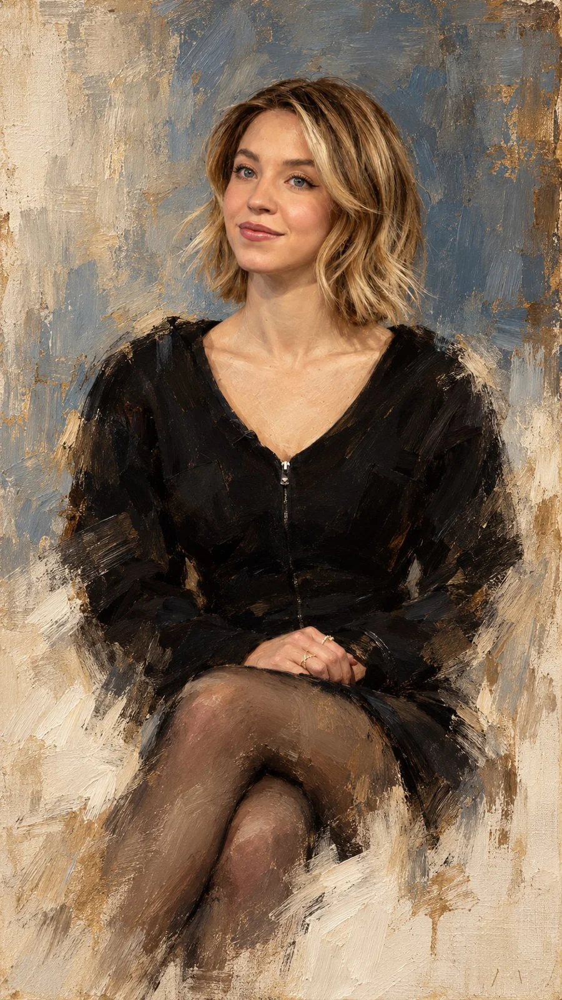

# Contemporary Painterly Oil Portrait

**中文标题：** 当代松散笔触油画肖像  
**ID:** `gi25-x-942` · **Mode:** `generate`  
**Categories:** `general`  
**Tags:** `x-twitter`, `community`, `gpt-image-2.5`, `x-direct`, `en`



### Contemporary Painterly Oil Portrait

```text
Sophisticated contemporary oil portrait painting with expressive, loose brushwork, combining refined semi-realistic portraiture, classical fine-art painting, and modern editorial painterly aesthetics. The subject is rendered with highly controlled yet visibly handcrafted oil strokes, layered pigments, soft impasto, delicate dry-brush marks, and expressive directional brushwork that follows the natural anatomy and volume of the face.

Facial features are detailed and semi-realistic, with luminous skin, natural texture, expressive eyes, carefully modeled nose and lips, and richly layered hair built from flowing individual brushstrokes. Use warm brown, deep umber, burnt sienna, ochre, muted peach, cream, ivory, soft gray-blue, charcoal, and subtle muted gold accents, matching the reference palette precisely. Highlights are predominantly warm ivory and creamy white, while shadows remain deep but soft and painterly.

The background uses the same desaturated blue-gray and warm ivory palette, appearing like an unfinished classical painted canvas. Broad vertical and horizontal brushstrokes, translucent paint layers, softly scraped areas, subtle dry-brush textures, and irregular painterly patches create an atmospheric studio-like backdrop. Keep the background simple, quiet, and organically integrated with the portrait rather than sharply separated.

The lower portion of the figure intentionally becomes unfinished and gradually dissolves into loose white and ivory brushstrokes. Clothing, shoulders, chest, and lower contours progressively lose definition, breaking into scattered semi-transparent strokes and fading pigment. Edges become incomplete, soft, irregular, and partially disappear into the background, creating the unmistakable impression of an intentionally unfinished oil painting. Do not create a hard bottom edge.

Maintain a refined balance between highly detailed facial realism and deliberately unfinished painterly abstraction. Visible brushwork, layered oil pigments, soft impasto, subtle canvas texture, natural imperfections, elegant tonal transitions, museum-quality portrait painting, cinematic atmosphere, timeless fine-art character.

NEGATIVE PROMPT: No photorealistic photography, no 3D CGI, no vector appearance, no hard digital outlines, no glossy rendering, no completely finished lower body, no sharp background separation.

Aspect ratio: 9:16
```

- **Recommended model:** `gpt-image-2.5-sunburst`
- **Settings:** _(defaults)_
- **Source:** [community](https://x.com/Goodmanprotocol/status/2112788259583799559) — @Goodmanprotocol
- **License note:** Original public X post; quoted with attribution — remix with attribution
- **Notes:** Collected directly from X; original post https://x.com/Goodmanprotocol/status/2112788259583799559; post text names GPT Image 2.5; discovered via X search, prompt re-verified against the original X post via api.fxtwitter.com; verified=True
- **Preview:** `previews/gi25-x-942.webp`
