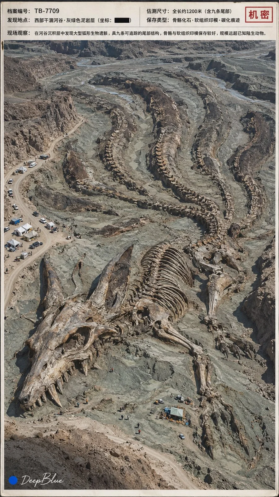

# Anime & Game Creatures as Giant Fossils Classified Archive Series

**中文标题：** 动漫游戏生物远古巨型化石机密档案系列  
**ID:** `gi25-x-943` · **Mode:** `generate`  
**Categories:** `general`, `poster-typography`  
**Tags:** `x-twitter`, `community`, `gpt-image-2.5`, `x-direct`, `zh`



### Anime & Game Creatures as Giant Fossils Classified Archive Series

```text
主题：经典动漫游戏生物角色 × 远古巨型化石 × 机密科考档案

每张从知名动漫、游戏或特摄作品中，独立选择一种非人类生物角色，优先选择轮廓鲜明、可通过骨骼、甲壳或组织印痕识别的角色。同批角色不重复，作品来源多样。

将角色构想为曾存在于远古地球的生物，保留标志性轮廓与结构，将关节、骨骼连接和组织转译为可信的古生物形态，其余部分可因埋藏、挤压和风化自然缺失。

保存方式匹配角色特征：骨架与局部遗骸表现骨骼；碳化轮廓、皮肤压痕或软组织印模保留长耳、特殊尾形与翼膜；矿化甲壳、鳞片印痕或骨质结构表现外部特征，避免趋同为普通恐龙骨架。

主体远超原设定或熟悉尺度，放大程度自由变化。以现场人物、车辆或工程设施建立清楚参照，透视与空间关系可信。

化石自然嵌入地层，完整程度、暴露范围与埋藏状态各异。遗骸符合倒伏、沉积和挤压关系，骨骼可错位、散落或局部关联。矿化、断裂与风化细节可信，关键特征清楚；颜色来自矿物、氧化和岩层差异，避免彩色雕像、玩具或模型质感。

画面呈现一页保存良好的内部机密科考档案彩色扫描件。一张现场证据照片占据绝大部分版面，清楚呈现遗骸、地层与尺度参照。环境匹配埋藏关系，自然光，普通相机取证摄影质感，曝光自然，细节清楚，低噪点。

窄页边以简洁中文记录档案编号、发现地点、估测尺寸、保存类型及一句现场观察，信息与照片对应，尺寸与现场参照一致。使用朴素工作文书排版，文字清楚可读，保留一处小型保密标记；如有涂黑，仅遮盖具体敏感字段，如有手写批注，应对应照片中的可见特征。

纸纹与扫描痕迹轻淡，不影响照片和文字辨读。现场照片延伸至页面左下区域，该区域保留适合白色签名辨读的自然暗部。

每张独立变化角色、保存状态、环境、机位、尺度参照及记录内容，避免重复遗骸姿态与主要构图，档案格式保持统一。

9:16竖版，n=10，分别输出10张独立单图，每张为一页完整档案，仅含一张现场照片，不拼图。

左下签名：深蓝色实心圆点在前，白色手写体“DeepBlue”在后。
```

- **Recommended model:** `gpt-image-2.5-sunburst`
- **Settings:** _(defaults)_
- **Source:** [community](https://x.com/DeepBlueX0/status/2112777629673902523) — @DeepBlueX0
- **License note:** Original public X post; quoted with attribution — remix with attribution
- **Notes:** Collected directly from X; original post https://x.com/DeepBlueX0/status/2112777629673902523; post text names GPT Image 2.5; discovered via X search, prompt re-verified against the original X post via api.fxtwitter.com; verified=True; the author posted this prompt as a reply under their own image thread https://x.com/DeepBlueX0/status/2112777613383229898
- **Preview:** `previews/gi25-x-943.webp`
