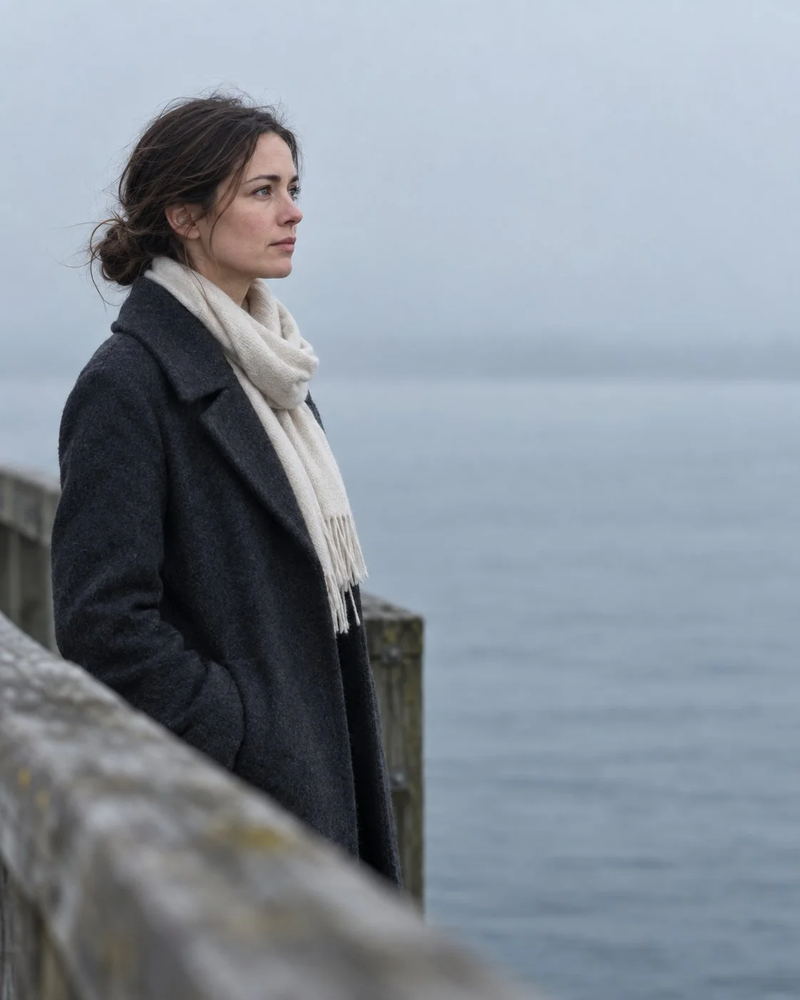

# Pier Negative-Space Editorial Portrait

**中文标题：** 栈桥负空间留白人像  
**ID:** `gi25-x-947` · **Mode:** `generate`  
**Categories:** `general`  
**Tags:** `x-twitter`, `community`, `gpt-image-2.5`, `x-direct`, `en`



### Pier Negative-Space Editorial Portrait

```text
Medium-wide shot of a lone adult woman positioned on the left third of the frame, eyes near the upper-third line, large negative space extending to the right in the direction of her gaze, blurred wooden pier railing in the extreme foreground creating depth, distant soft foggy water horizon quietly separated in the background.

She wears a charcoal wool coat over a soft ivory scarf, hair in a low loose bun with a few flyaways, quiet focused expression looking toward the empty right side of frame (not at camera). Cool overcast morning light, restrained contrast, natural skin texture, cinematic editorial photography, 50mm lens, shallow depth of field, photorealistic, vertical 4:5, no city skyline landmarks, no tourism poster layout, no text, no logo, no watermark.
```

- **Recommended model:** `gpt-image-2.5-sunburst`
- **Settings:** _(defaults)_
- **Source:** [community](https://x.com/Alyssa4aicreate/status/2112705125487706535) — @Alyssa4aicreate
- **License note:** Original public X post; quoted with attribution — remix with attribution
- **Notes:** Collected directly from X; original post https://x.com/Alyssa4aicreate/status/2112705125487706535; post text names GPT Image 2.5; discovered via X search, prompt re-verified against the original X post via api.fxtwitter.com; verified=True; author says it was made with GPT Image 2.5 on Token360 and credits the idea as inspired by @beginnersblog1
- **Preview:** `previews/gi25-x-947.webp`
