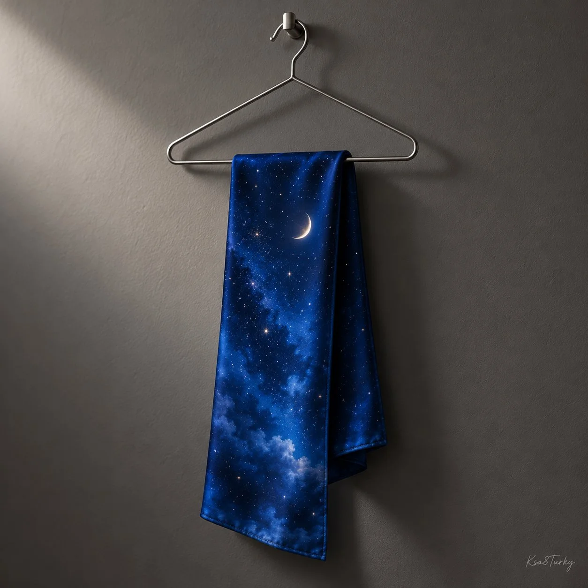

# Intangible Phenomenon as Tangible Object Surreal Still Template

**中文标题：** 无形自然现象实物化超现实静物模板  
**ID:** `gi25-x-948` · **Mode:** `generate`  
**Categories:** `general`  
**Tags:** `x-twitter`, `community`, `gpt-image-2.5`, `x-direct`, `en`



### Intangible Phenomenon as Tangible Object Surreal Still Template

```text
Create a square premium surreal editorial photograph of [INTANGIBLE NATURAL PHENOMENON] treated as one tangible [EVERYDAY OBJECT] resting naturally on [SIMPLE SUPPORT]. Show a cohesive physical form, convincing folds or edges, restrained texture and believable contact shadows. Minimal neutral studio, directional light, generous negative space and one focal point. No miniature worlds, people, brands or claims. Small handwritten Ksa8Turky signature; no other text. Conceptual fantasy.
```

- **Recommended model:** `gpt-image-2.5-sunburst`
- **Settings:** _(defaults)_
- **Source:** [community](https://x.com/ksa8Turky/status/2112669690182947256) — @ksa8Turky
- **License note:** Original public X post; quoted with attribution — remix with attribution
- **Notes:** Collected directly from X; original post https://x.com/ksa8Turky/status/2112669690182947256; post text names GPT Image 2.5; discovered via X search, prompt re-verified against the original X post via api.fxtwitter.com; verified=True; the prompt asks for the author's own handwritten signature on the image
- **Preview:** `previews/gi25-x-948.webp`
