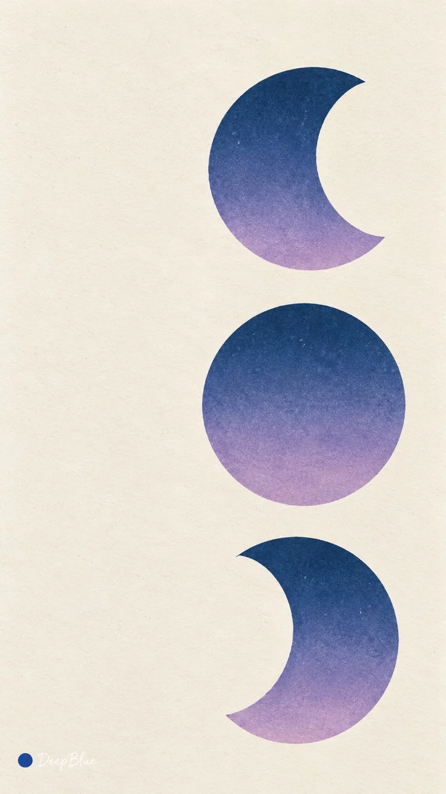

# Split-Fountain Screen-Print Nature Wallpaper (Variant 1/4)

**中文标题：** 同版渐变丝网印刷自然意象壁纸（变体 1/4）  
**ID:** `gi25-x-953` · **Mode:** `generate`  
**Categories:** `general`, `poster-typography`  
**Tags:** `x-twitter`, `community`, `gpt-image-2.5`, `x-direct`, `zh`



### Split-Fountain Screen-Print Nature Wallpaper (Variant 1/4)

```text
主题：极简自然意象 × Split Fountain 同版渐变丝网印刷

每张从日落、海浪、山峰、沙丘、月相中独立选择一种，以少量简练的大形与色面表现，保留主体辨识度与宽阔留白。

独立探索协调的双色或多色油墨组合，以及渐变方向、混色范围与图形布局。颜色通过同一张丝网印版进入图形内部，沿统一方向自然交融，两端保留原色，中间形成连续柔和的混色过渡。

哑光墨层平整细腻，局部保留轻微墨色变化，轮廓明确而略有手工印刷参差。暖白纸张肌理隐约可见，整体简练、温润，具有复古艺术印刷品的质感。

每张重新构思，主体、配色与构图组合各不相同。

9:16竖版，n=10，每张独立单图。
左下签名：深蓝色实心圆点在前，白色自然手写体“DeepBlue”在后。
```

- **Recommended model:** `gpt-image-2.5-sunburst`
- **Settings:** _(defaults)_
- **Source:** [community](https://x.com/DeepBlueX0/status/2112574010928308548) — @DeepBlueX0
- **License note:** Original public X post; quoted with attribution — remix with attribution
- **Notes:** Collected directly from X; original post https://x.com/DeepBlueX0/status/2112574010928308548; post text names GPT Image 2.5; discovered via X search, prompt re-verified against the original X post via api.fxtwitter.com; verified=True; variant 1 of 4 in the author's thread
- **Preview:** `previews/gi25-x-953.webp`
