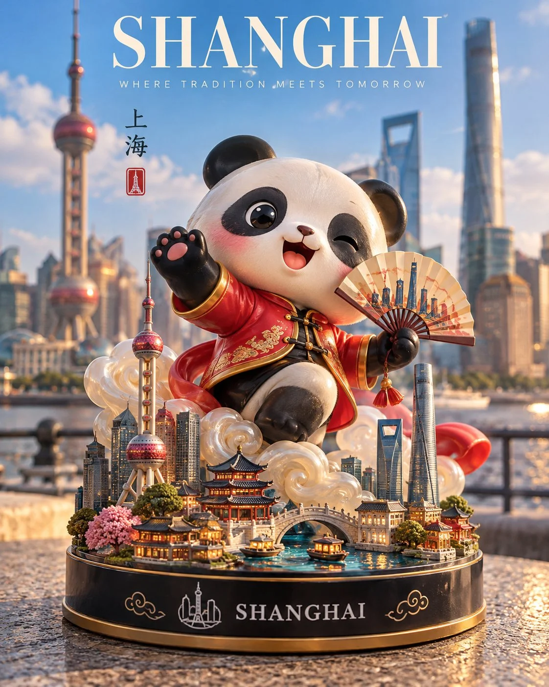

# Destination Designer-Toy Collectible Template

**中文标题：** 城市地标潮玩手办模板  
**ID:** `gi25-x-959` · **Mode:** `generate`  
**Categories:** `general`  
**Tags:** `x-twitter`, `community`, `gpt-image-2.5`, `x-direct`, `en`



### Destination Designer-Toy Collectible Template

```text
Create a premium 4:5 vertical 3D designer-toy collectible inspired by [COUNTRY / CITY / DESTINATION].

CHARACTER:
Transform the destination’s most iconic symbol, mascot, or landmark into a cute, stylized vinyl figurine. Give it distinctive local features, a playful pose, an expressive face, and a smooth glossy finish. Add a signature sculptural effect inspired by the location, such as flowing water, swirling clouds, sparkling energy, or another culturally relevant element.

DISPLAY BASE:
Place the figurine on a polished circular base featuring miniature versions of the destination’s most recognizable landmarks, tiny trees, and carefully sculpted local details. Add “[DESTINATION]” in clean white lettering on the front, accompanied by a simple emblem inspired by the location.

SETTING:
Photograph the collectible outdoors in an authentic, recognizable location, with the real landmark or cityscape softly blurred in the background. Include a tasteful promotional banner reading “[DESTINATION SLOGAN]” and place the toy on a natural surface that complements the setting.

LIGHTING & MATERIALS:
Bright natural daylight, soft realistic shadows, detailed reflections, polished vinyl, tactile sculpted surfaces, and crisp miniature craftsmanship.

STYLE:
High-end designer-toy photography meets premium travel-souvenir advertising. Vibrant, joyful, imaginative, and professionally art-directed.

Automatically select a fitting character design, signature effect, miniature landmarks, emblem, and background based on the destination.

Avoid generic characters, inaccurate landmarks, clutter, people in focus, excessive text, watermarks, and logos.

FORMAT: Strict 4:5 vertical composition.
```

- **Recommended model:** `gpt-image-2.5-sunburst`
- **Settings:** _(defaults)_
- **Source:** [community](https://x.com/Goodmanprotocol/status/2112560854759879032) — @Goodmanprotocol
- **License note:** Original public X post; quoted with attribution — remix with attribution
- **Notes:** Collected directly from X; original post https://x.com/Goodmanprotocol/status/2112560854759879032; post text names GPT Image 2.5; discovered via X search, prompt re-verified against the original X post via api.fxtwitter.com; verified=True
- **Preview:** `previews/gi25-x-959.webp`
