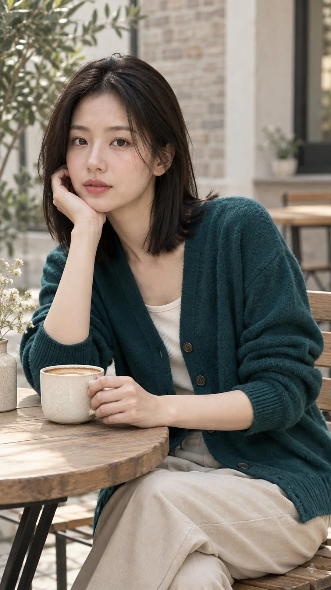

# Theme Color on Clothing Only Portrait (Six-Slot Prompt)

**中文标题：** 主题色只上衣服人像（六格结构提示词）  
**ID:** `gi25-x-965` · **Mode:** `generate`  
**Categories:** `general`  
**Tags:** `x-twitter`, `community`, `gpt-image-2.5`, `x-direct`, `zh`



### Theme Color on Clothing Only Portrait (Six-Slot Prompt)

```text
主题色只上衣服人像，竖幅 9:16，写实摄影。
主题色落点：本期主题色为竹青（偏青的墨绿蓝）；仅落在服装与面料区域。
肤色锁：浅暖白肤色带一点奶杏，脸颊有自然血色；肤色保持自然肤色相，皮肤纹理清晰可见。
环境中性色：背景保持中性、低饱和，是灰、米、木色一类与主题色无关的色系；墙面、地面、桌面等环境色保持各自的中性本色。
道具同色规则：配饰、包袋、杯具、家具等道具禁止使用主题色；道具保持灰、米、原木、陶瓷、金属等中性色。
人物面孔：虚构的成年女性，二十五岁上下，原创东亚或混血面孔；鹅蛋脸，微圆下颌，内双，鼻梁中等高，薄唇自然粉；浅暖白肤色带一点奶杏，脸颊有自然血色；齐肩黑棕直发，中分，两侧轻贴脸；偏纤瘦自然比例，肩窄；气质安静、略带街头感；表情平静，目光朝向镜头。
场景与穿搭：白天咖啡馆庭院，浅木桌与米白墙，背景虚焦为米灰砖墙；穿竹青色针织开衫罩米白内搭与浅卡其裤；杯具与桌面保持原木与陶瓷中性色。
姿势与构图：半身坐在庭院桌边，一手轻扶杯沿，头微侧，目光朝向镜头；衣服上的竹青是画面主色块，脸与背景保持原有肤色与中性色。
排除：全局滤镜、整图染色、跨画面 color grade、皮肤染主题色、背景跟色、道具同色、水印、logo、可读文字、乱码字、磨皮塑料感、像真实名人的面孔、未成年人或幼态特征、第二个人物、性感化姿势、浓妆、节日装饰。
```

- **Recommended model:** `gpt-image-2.5-sunburst`
- **Settings:** _(defaults)_
- **Source:** [community](https://x.com/shyboy1211/status/2112518961191403926) — @shyboy1211
- **License note:** Original public X post; quoted with attribution — remix with attribution
- **Notes:** Collected directly from X; prompt posted as the author's reply https://x.com/shyboy1211/status/2112518961191403926 to https://x.com/shyboy1211/status/2112518959538770069, which carries the images and names GPT Image 2.5; discovered via X search, prompt re-verified against the original X post via api.fxtwitter.com; verified=True
- **Preview:** `previews/gi25-x-965.webp`
