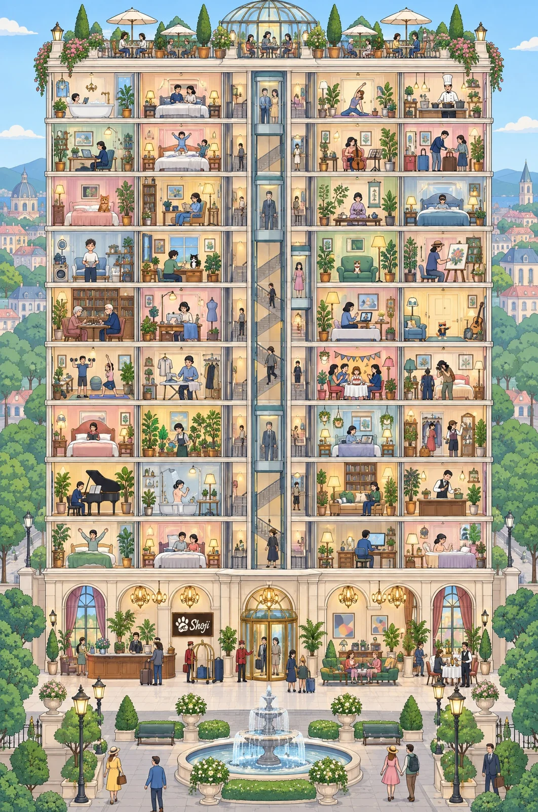

# Find-the-Hidden-Cats Cross-Section Hotel Tower

**中文标题：** 找猫游戏：剖面塔楼酒店插画  
**ID:** `gi25-x-968` · **Mode:** `generate`  
**Categories:** `general`  
**Tags:** `x-twitter`, `community`, `gpt-image-2.5`, `x-direct`, `en`



### Find-the-Hidden-Cats Cross-Section Hotel Tower

```text
A clean, flat, graphic illustration in a limited pastel palette (powder pink, mint green, butter yellow, powder blue, lavender, cream walls, thin dark-brown outlines), vertical 2:3, a "find the hidden cats" picture in the spirit of a classic seek-and-find book. A very tall, perfectly left-right symmetrical grand hotel tower drawn as a cross-section, as if the whole front wall were removed like a dollhouse, so every room is visible at once, seen from far away in a pulled-back view so that the picture holds a huge amount of detail. Straight frontal view, flat perspective, thin straight floor lines. Nine guest floors with four rooms each (36 rooms, two on each side of a central column of staircases and glass elevators) on a wide ground-floor lobby with a revolving door, a reception desk, a lounge and a restaurant, crowned by a rooftop garden terrace with a small glass dome, umbrellas and potted trees. The building fills about 80% of the picture width. Around it: a front plaza with a fountain, lamp posts and clipped hedges, rows of trees on both sides, distant low city buildings and hills, a pale blue sky with a few tiny clouds.

Every room is a tiny story, all different, with small people and small furniture (an adult standing in a room is only about 75 pixels tall in a 2048-pixel-high picture): a guest reading in a bathtub, a couple on a bed, a child jumping on a bed, a chef cooking, a painter at an easel, a woman playing a cello, a man ironing a shirt, a family packing suitcases, a guest asleep with a sleeping mask, a gardener watering plants, an elderly couple playing chess, a maid with towels, a pianist, a tailor, a yoga class, a birthday party, a little gym, a bellhop pushing a luggage trolley. Warm lamplight in the rooms, about 200 tiny people in plain everyday clothes. Clean and sharp: perfectly straight lines, natural proportions, clear tiny hands and faces, every object recognizable.

A logo appears exactly ONCE, small: a modest dark wooden signboard on the lobby wall beside the reception desk (about 4% of the picture width), showing a cream-colored cat paw print whose big pad contains a swirling ocean-wave shape, with the word "Shoji" in cream cursive brush lettering to its right. Apart from that logo there are NO letters, NO words and NO numbers anywhere.

Exactly FOUR cats are hidden in the scene and NO other animal: no birds, no dogs, no cat ears or masks on anybody, no cat painted on any wall or sign, no stuffed animals. All four are in different guest rooms on the middle floors, in the open but easy to overlook, and ALL FOUR ARE THE SAME SIZE: about 1.4% of the picture height each (roughly 30 pixels tall in a 2048-pixel-high picture), about two fifths of an adult's height, no cat bigger than another:
(1) a brown mackerel tabby (warm brown fur with dark stripes, white muzzle) sitting upright on the end of a bed in a third-floor room at the far left;
(2) a black-and-white "hachiware" cat (black head and back, a white blaze splitting the face, white chest and paws) sitting upright on a desk beside a window in a fourth-floor room, left of the central column;
(3) a calico cat (mostly white with distinct orange and black patches) sitting upright on a green sofa in a fourth-floor room, right of the central column;
(4) an upright standing orange tabby cat about three heads tall, exactly as tall as the other three cats, wearing black wayfarer sunglasses whose lenses are blue on one side and red on the other, an open black leather biker jacket, rolled-up denim shorts and cream sneakers, pointing with one hand, in a fifth-floor room at the far right. He is a tiny figure as small as the seated cats (about 30 pixels tall), far smaller than the people around him.
The tabby, hachiware and calico are real four-legged cats with a thin red collar and a tiny gold bell, no clothes. No cat appears in the lower third of the picture. No black or dark round object that could be mistaken for a cat. No watermark, no frame, no border.
```

- **Recommended model:** `gpt-image-2.5-sunburst`
- **Settings:** _(defaults)_
- **Source:** [community](https://x.com/Shoji_ai/status/2112478934667276479) — @Shoji_ai
- **License note:** Original public X post; quoted with attribution — remix with attribution
- **Notes:** Collected directly from X; prompt posted as the author's reply https://x.com/Shoji_ai/status/2112478934667276479 to https://x.com/Shoji_ai/status/2112478933073490300, which carries the images and names GPT Image 2.5; discovered via X search, prompt re-verified against the original X post via api.fxtwitter.com; verified=True; Shoji Cat is the author's own recurring mascot
- **Preview:** `previews/gi25-x-968.webp`
