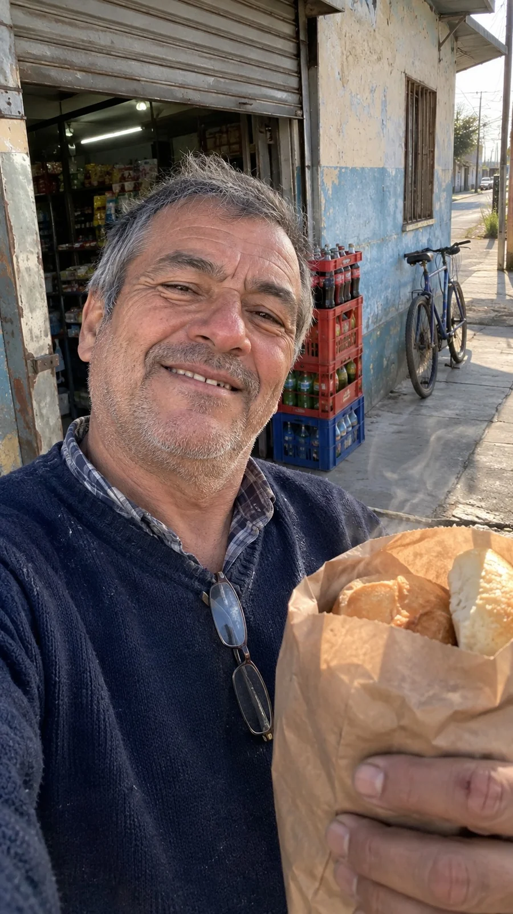

# Neighborhood Shop Morning Selfie UGC (JSON)

**中文标题：** 街角小店清晨大叔自拍 UGC（JSON）  
**ID:** `gi25-x-969` · **Mode:** `generate`  
**Categories:** `general`  
**Tags:** `x-twitter`, `community`, `gpt-image-2.5`, `x-direct`, `en`



### Neighborhood Shop Morning Selfie UGC (JSON)

```text
{
 "prompt_type": "candid_smartphone_ugc",
 "objective": "A proud front-camera selfie of a man in his late 50s outside a small neighborhood corner store early in the morning, holding a warm paper bag of fresh bread. Must look like a real unedited photo from someone's camera roll, not an ad or AI image.",
 "canvas": {
  "aspect_ratio": "9:16",
  "framing": "front-camera selfie, arm's length, slightly from below, a bit crooked",
  "camera_character": "iPhone front camera, early morning light, slight grain, mild lens distortion at the edges, no bokeh"
 },
 "scene": {
  "location": "sidewalk outside a small neighborhood corner store in a South American city",
  "background": "faded painted wall, a metal roll-up shutter half open, a bike leaning on the wall, plastic crates of soda bottles without labels",
  "time": "7:15 am"
 },
 "subject": {
  "identity": "original fictional adult person",
  "age_appearance": "late 50s, Latino",
  "hair": "short grey hair, receding hairline, a bit messy",
  "expression": "warm crooked grin, eyes squinting",
  "outfit": "old navy wool sweater with a stretched collar over a checked shirt",
  "details": "reading glasses hanging from the collar, small cut healing on the knuckle, steam rising from the bread bag",
  "hand": "holding the paper bag of bread up toward the lens, slightly out of focus",
  "skin": {
   "texture": "deep wrinkles, sun spots, visible pores, grey stubble, slightly red nose from the cold",
   "makeup": "none",
   "finish": "matte, no gloss, no glow"
  }
 },
 "lighting": {
  "key_light": "low cold morning sun from the side",
  "shadows": "hard long shadows, one side of the face brighter",
  "overall": "real, unflattering, natural phone exposure"
 },
 "realism_rules": [
  "natural asymmetry",
  "real fabric wrinkles",
  "lived-in background",
  "correct hands with five fingers",
  "no text, no UI, no logos"
 ],
 "negative_prompt": [
  "plastic skin",
  "airbrushed",
  "beauty filter",
  "glow",
  "dewy skin",
  "glossy lips",
  "long eyelashes",
  "flawless skin",
  "perfect symmetry",
  "studio lighting",
  "CGI",
  "3D render",
  "bokeh",
  "extra fingers",
  "distorted hands",
  "text",
  "logos",
  "watermark"
 ]
}
```

- **Recommended model:** `gpt-image-2.5-sunburst`
- **Settings:** _(defaults)_
- **Source:** [community](https://x.com/trustmyedge/status/2112491516824273263) — @trustmyedge
- **License note:** Original public X post; quoted with attribution — remix with attribution
- **Notes:** Collected directly from X; original post https://x.com/trustmyedge/status/2112491516824273263; post text names GPT Image 2.5; discovered via X search, prompt re-verified against the original X post via api.fxtwitter.com; verified=True
- **Preview:** `previews/gi25-x-969.webp`
