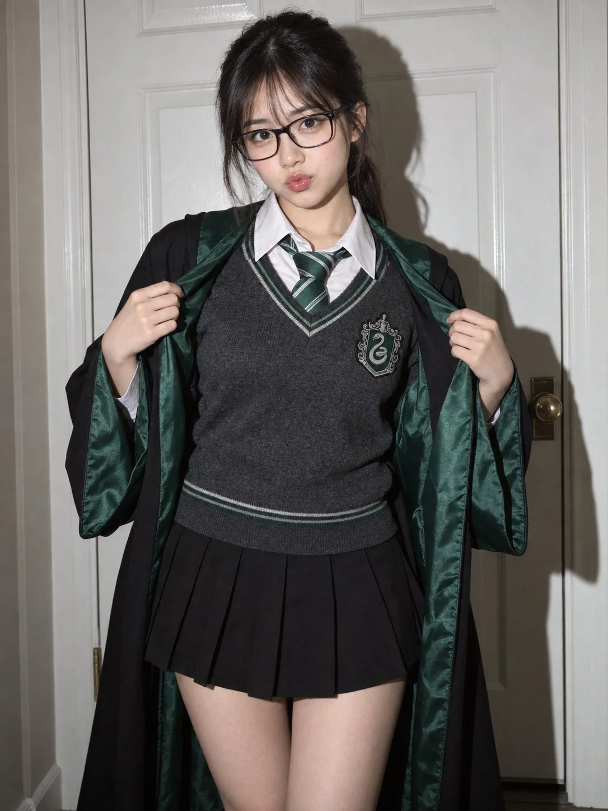

# Slytherin Student Flash Portrait in a Hallway

**中文标题：** 走廊闪光灯斯莱特林学生人像  
**ID:** `gi25-x-971` · **Mode:** `generate`  
**Categories:** `general`  
**Tags:** `x-twitter`, `community`, `gpt-image-2.5`, `x-direct`, `en`



### Slytherin Student Flash Portrait in a Hallway

```text
Medium full shot, eye-level cinematic flash portrait of an adorable early-20s East Asian woman portraying a playful Slytherin academy student in a quiet interior hallway. Standing facing forward with an endearing posture, she uses both hands to hold open the front edges of her black wizard robe, revealing her tailored uniform underneath. Her glossy lips are pursed into a cute, subtle pout, looking straight into the camera through stylish black rectangular eyeglasses with bright, lively eyes.

Her facial features are youthful and charming: smooth fair skin, soft cheek contours, and clear dark almond eyes framed by neat black spectacles and delicate natural lashes. Her dark hair is gathered in a casual low ponytail, featuring light wispy fringe bangs across her brow and soft face-framing tendrils along her temples.

She wears a complete classic wizarding school uniform: an open black wool robe featuring wide sleeves lined with rich emerald-green satin. Underneath is a fitted charcoal-grey V-neck knit long-sleeve sweater bordered with green and white striped trim, displaying a silver serpent crest patch on the chest, layered over a crisp white collared shirt and an emerald-green and silver diagonal-striped silk necktie, paired with a matching black pleated mini skirt.

The setting is simple and modern: she stands directly before a clean, white paneled interior wooden door that catches her silhouette.

Illuminated by raw direct on-camera flash, creating clean, crisp highlights across her eyeglasses, fair skin, and satin robe lining, while casting a sharp, defined dark drop-shadow onto the white door behind her. Photographed on a 50mm lens at f/2.2, ISO 200, 1/250s, delivering authentic fabric knit textures, fine film grain, and an authentic, fashionable dark academia mood.
```

- **Recommended model:** `gpt-image-2.5-sunburst`
- **Settings:** _(defaults)_
- **Source:** [community](https://x.com/johnAGI168/status/2112789842241159667) — @johnAGI168
- **License note:** Original public X post; quoted with attribution — remix with attribution
- **Notes:** Collected directly from X; original post https://x.com/johnAGI168/status/2112789842241159667; post text names GPT Image 2.5; discovered via X search, prompt re-verified against the original X post via api.fxtwitter.com; verified=True; post names ChatGPT Images 2.5
- **Preview:** `previews/gi25-x-971.webp`
