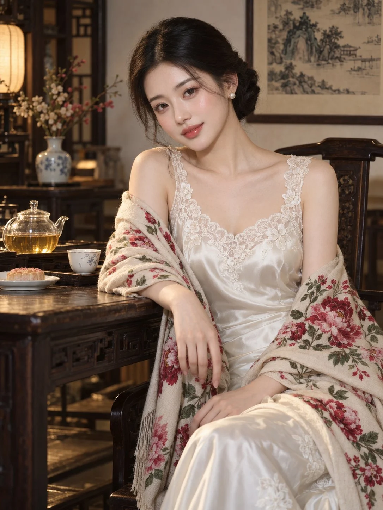

# Jiangnan Tea Room Flash Portrait

**中文标题：** 江南茶室闪光灯古典人像  
**ID:** `gi25-x-972` · **Mode:** `generate`  
**Categories:** `general`  
**Tags:** `x-twitter`, `community`, `gpt-image-2.5`, `x-direct`, `en`



### Jiangnan Tea Room Flash Portrait

```text
Medium shot, eye-level cinematic flash portrait of a graceful early-20s East Asian woman embodying traditional Jiangnan aristocratic elegance inside a quiet Chinese tea room. Seated poised beside an antique dark wooden table, her right forearm rests gracefully along the edge of the timber with slender relaxed fingers cascading downward, wrapped loosely in an ornate floral shawl. She tilts her head slightly, offering a serene, gentle, and soul-stirring gaze directly into the camera.

Her facial features are classical and breathtaking: smooth alabaster porcelain skin, a soft feminine oval jawline, clear dark almond eyes filled with tender warmth, and glossy coral-rose lips. Her makeup is luminous and dewy, featuring a delicate peach-pink blush on her cheeks crowned by glistening champagne-gold highlighter on her high cheekbones. Her raven-black hair is parted neatly down the center and pulled back into a neat, elegant low chignon bun, accented by a classic single round white pearl stud earring on her ear.

She is dressed in an exquisite ivory-white silk satin dress with a scalloped neckline trimmed in delicate sheer white floral lace. Draped luxuriously over both shoulders and arms is an off-white cashmere shawl richly patterned with blooming crimson and pink peony flower motifs and sage-green foliage, falling softly around her lap.

The setting is an authentic vintage tea chamber: on the dark lacquered wooden tea table beside her sits a clear glass teapot filled with brewed golden tea, a delicate white porcelain teacup, and a small dessert plate, set against a quiet, warm off-white wall decorated with a small traditional Chinese ink painting frame.

Illuminated by soft on-camera flash key lighting, casting a dewy, radiant glow across her glistening cheekbones and white lace trims, while letting the room recede into warm, nostalgic vintage shadows. Shot on a 50mm portrait lens at f/2.2, ISO 200, 1/160s, capturing authentic skin micro-pores, intricate lace stitching, fluid satin drape, and a timeless, poetic oriental elegance.
```

- **Recommended model:** `gpt-image-2.5-sunburst`
- **Settings:** _(defaults)_
- **Source:** [community](https://x.com/johnAGI168/status/2112569911645974748) — @johnAGI168
- **License note:** Original public X post; quoted with attribution — remix with attribution
- **Notes:** Collected directly from X; original post https://x.com/johnAGI168/status/2112569911645974748; post text names GPT Image 2.5; discovered via X search, prompt re-verified against the original X post via api.fxtwitter.com; verified=True; post names ChatGPT Images 2.5
- **Preview:** `previews/gi25-x-972.webp`
