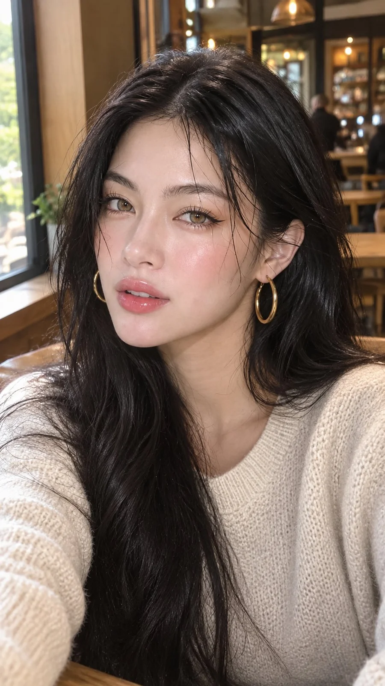

# Soft Luxury Café Close-Up Portrait

**中文标题：** 柔光轻奢咖啡馆特写人像  
**ID:** `gi25-x-974` · **Mode:** `generate`  
**Categories:** `general`  
**Tags:** `x-twitter`, `community`, `gpt-image-2.5`, `x-direct`, `en`



### Soft Luxury Café Close-Up Portrait

```text
Ultra-realistic close-up portrait of a beautiful young woman with long, thick, naturally wavy jet-black hair, soft face-framing strands, warm hazel-brown eyes, delicate facial features, naturally full glossy peach-pink lips, subtle rosy blush, flawless luminous skin, and elegant black winged eyeliner with long curled lashes. She is wearing large gold oval hoop earrings and a cozy cream-colored knitted sweater with a soft textured pattern.

She is sitting inside a cozy, upscale café beside a large window, with warm natural daylight illuminating her face. The background features wooden tables, chairs, warm pendant lights, and a softly blurred café interior with beautiful golden bokeh. She is looking directly at the camera with a gentle, confident expression and slightly parted lips, creating an effortless, sophisticated feminine aesthetic.

Photography style: high-end beauty photography, candid selfie composition, eye-level camera angle, tight medium close-up, realistic skin texture, soft diffused lighting, natural facial proportions, detailed individual hair strands, subtle highlights on the cheeks and lips, shallow depth of field, creamy background blur, warm neutral color grading, photorealistic, 85mm portrait lens, f/1.8, ultra-detailed, 4K quality.

Aspect ratio 9:16, vertical portrait, natural beauty, soft luxury café aesthetic, no text, no watermark.
```

- **Recommended model:** `gpt-image-2.5-sunburst`
- **Settings:** _(defaults)_
- **Source:** [community](https://x.com/nawalsehar/status/2113489244912316478) — @nawalsehar
- **License note:** Original public X post; quoted with attribution — remix with attribution
- **Notes:** Collected directly from X; original post https://x.com/nawalsehar/status/2113489244912316478; post text names GPT Image 2.5; discovered via Bin0754/gpt-image-gallery index, prompt re-verified against the original X post via api.fxtwitter.com; verified=True
- **Preview:** `previews/gi25-x-974.webp`
