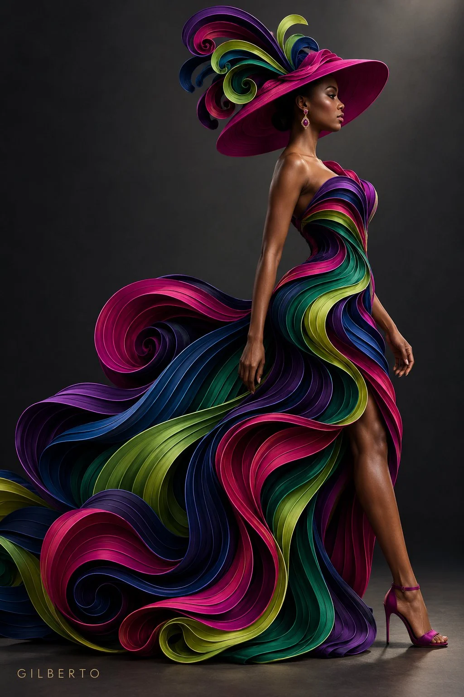

# Paper-Quilled Haute Couture Gown Template

**中文标题：** 纸艺衍纸高定礼服模板  
**ID:** `gi25-x-979` · **Mode:** `generate`  
**Categories:** `general`  
**Tags:** `x-twitter`, `community`, `gpt-image-2.5`, `x-direct`, `en`



### Paper-Quilled Haute Couture Gown Template

```text
Generate a full-body high-fashion shot of a [SUBJECT / MODEL DESCRIPTION] in a [POSE / ACTION], wearing an avant-garde paper-quilled haute couture gown made of fluid, overlapping 3D ribbon strands. The dress features [DRESS FEATURES: e.g., a fitted corset bodice and sweeping train] made of swooping ribbon layers in a gradient of [COLOR PALETTE: e.g., vivid cobalt, emerald green, and gold]. Accessories include a [HEADWEAR / ACCENTS: e.g., wide-brimmed matching hat with quilled plume details]. Set against a [BACKGROUND COLOR: e.g., dark charcoal grey] background with dramatic studio spotlighting highlighting texture and fine edges. Rendered in crisp, high-contrast 3D detail.
```

- **Recommended model:** `gpt-image-2.5-sunburst`
- **Settings:** _(defaults)_
- **Source:** [community](https://x.com/yourPlugAI/status/2114219176646586620) — @yourPlugAI
- **License note:** Original public X post; quoted with attribution — remix with attribution
- **Notes:** Collected directly from X; original post https://x.com/yourPlugAI/status/2114219176646586620; post text names GPT Image 2.5; discovered via Bin0754/gpt-image-gallery index, prompt re-verified against the original X post via api.fxtwitter.com; verified=True; the post says a placeholder key is attached below; the trailing pointer line is omitted
- **Preview:** `previews/gi25-x-979.webp`
