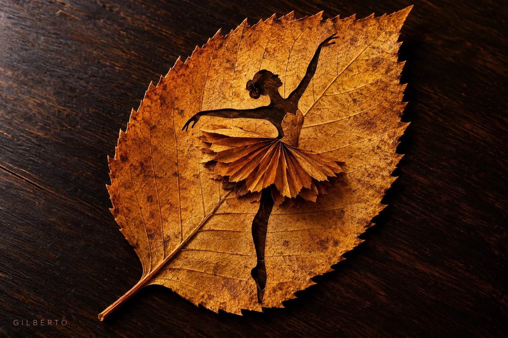

# Leaf-Carving Artwork Flat-Lay Macro Template

**中文标题：** 树叶雕刻艺术平铺微距模板  
**ID:** `gi25-x-980` · **Mode:** `generate`  
**Categories:** `general`  
**Tags:** `x-twitter`, `community`, `gpt-image-2.5`, `x-direct`, `en`



### Leaf-Carving Artwork Flat-Lay Macro Template

```text
Flat-lay macro photograph of delicate leaf-carving artwork featuring [SUBJECT/POSTURE, e.g., a graceful ballerina en pointe / a romantic dancing couple holding hands], meticulously sculpted from a single [LEAF TYPE/COLOR, e.g., large serrated golden-amber maple leaf / dry oak leaf].

The figure features [3D DETAIL/TEXTURE, e.g., a fan-pleated 3D leaf-slice dress / visible leaf veins running across the body]. Set against a [BACKGROUND SURFACE, e.g., dark polished wood surface / light birch wood table / wet rainy asphalt path] under [LIGHTING STYLE, e.g., warm cinematic side-lighting / soft studio backlighting].

Ultra-detailed organic textures, clean composition, artistic design. --ar [ASPECT RATIO, e.g., 3:2 / 16:9 / 1:1]
```

- **Recommended model:** `gpt-image-2.5-sunburst`
- **Settings:** _(defaults)_
- **Source:** [community](https://x.com/yourPlugAI/status/2113133036116041739) — @yourPlugAI
- **License note:** Original public X post; quoted with attribution — remix with attribution
- **Notes:** Collected directly from X; original post https://x.com/yourPlugAI/status/2113133036116041739; post text names GPT Image 2.5; discovered via Bin0754/gpt-image-gallery index, prompt re-verified against the original X post via api.fxtwitter.com; verified=True
- **Preview:** `previews/gi25-x-980.webp`
