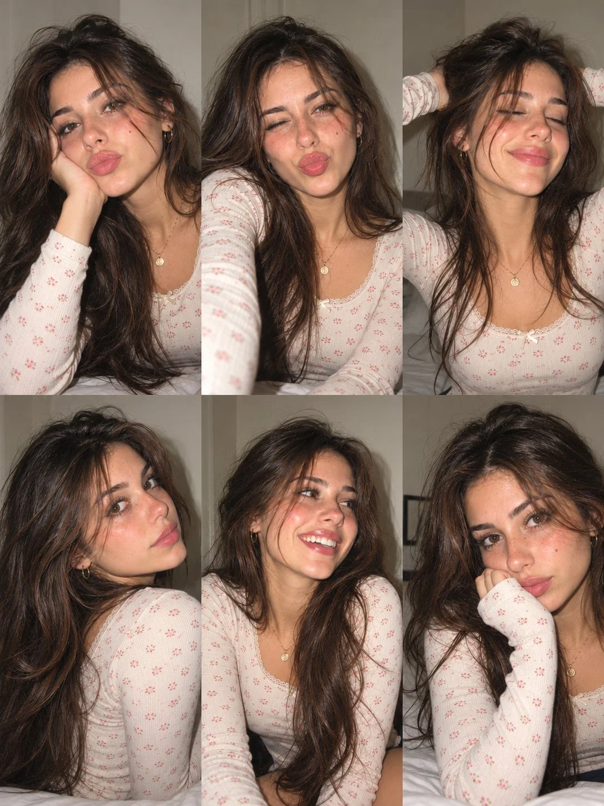

# French Girl 3×2 Six-Photo Portrait Collage

**中文标题：** 法式女孩 3×2 六宫格人像拼贴  
**ID:** `gi25-x-982` · **Mode:** `generate`  
**Categories:** `general`, `character-consistency`  
**Tags:** `x-twitter`, `community`, `gpt-image-2.5`, `x-direct`, `en`



### French Girl 3×2 Six-Photo Portrait Collage

```text
Create an ultra-realistic 6-photo portrait collage arranged in a seamless 3×2 grid, featuring the same naturally beautiful young French woman in her early 20s. She has warm fair-olive skin, delicate freckles across her cheeks and nose, expressive hazel-brown eyes, long, naturally tousled dark chestnut hair, full eyebrows, and naturally glossy pink lips. Her appearance should feel authentic, youthful, and effortlessly Parisian.

Photography Style: Candid European Instagram photo dump, resembling casual Canon PowerShot G7 X Mark III snapshots. Direct camera flash, crisp facial details, realistic skin pores, subtle digital grain, natural shadows, slightly imperfect framing, and warm indoor lighting.

Setting: A cozy bedroom with an off-white textured wall, neutral bedding, and a softly blurred background. Maintain consistent surroundings throughout all six photographs.

Outfit & Accessories: She wears the same cream-colored, long-sleeved ribbed top with tiny red floral prints and delicate lace trim in every photograph. The top has a modest, higher neckline with full chest coverage. Add small gold hoop earrings and a delicate gold pendant necklace. Her makeup is minimal, with naturally flushed cheeks, glossy lips, and lightly defined lashes. Her hairstyle remains consistent in color and length, but falls differently with each pose.

Six Distinct Poses:

1. Playful selfie: Resting one cheek against her hand, looking into the camera with gently pursed lips and a relaxed expression.
2. Winking snapshot: Looking directly into the lens, winking playfully with a slight pout, one arm casually extended toward the camera.
3. Relaxed happy moment: Eyes closed, smiling softly with her head tilted back slightly and both hands casually lifting her hair.
4. Over-the-shoulder portrait: Turning her face toward the camera over one shoulder, giving a subtle side glance with loose hair cascading naturally.
5. Caught laughing: Looking toward someone outside the frame, laughing genuinely with her head tilted sideways and hair falling across one cheek.
6. Quiet cozy mood: Leaning against a pillow, resting her chin against the sleeve of her top, gazing thoughtfully into the camera.

Identity Consistency: The exact same woman must appear in all six photographs, with consistent facial proportions, eye color, freckles, skin tone, and hair color. Each frame must have a distinctly different pose, expression, head angle, and natural hair arrangement.

Realism Details: Authentic skin texture, fine baby hairs, natural facial asymmetry, believable hands, sharp eyes, realistic fabric texture, subtle exposure variations, and natural compact-camera flash. Avoid excessive retouching, artificial skin smoothing, duplicated expressions, malformed fingers, distorted anatomy, or overly polished AI-generated aesthetics.

Output: Vertical 3:4 aspect ratio, exactly six photographs in a balanced 3-column × 2-row grid, clean alignment, no gutters, no borders, no text, no watermark. Photorealistic, intimate, youthful, spontaneous, and effortlessly French.
```

- **Recommended model:** `gpt-image-2.5-sunburst`
- **Settings:** _(defaults)_
- **Source:** [community](https://x.com/john_my07/status/2113636699888885986) — @john_my07
- **License note:** Original public X post; quoted with attribution — remix with attribution
- **Notes:** Collected directly from X; original post https://x.com/john_my07/status/2113636699888885986; post text names GPT Image 2.5; discovered via Bin0754/gpt-image-gallery index, prompt re-verified against the original X post via api.fxtwitter.com; verified=True
- **Preview:** `previews/gi25-x-982.webp`
