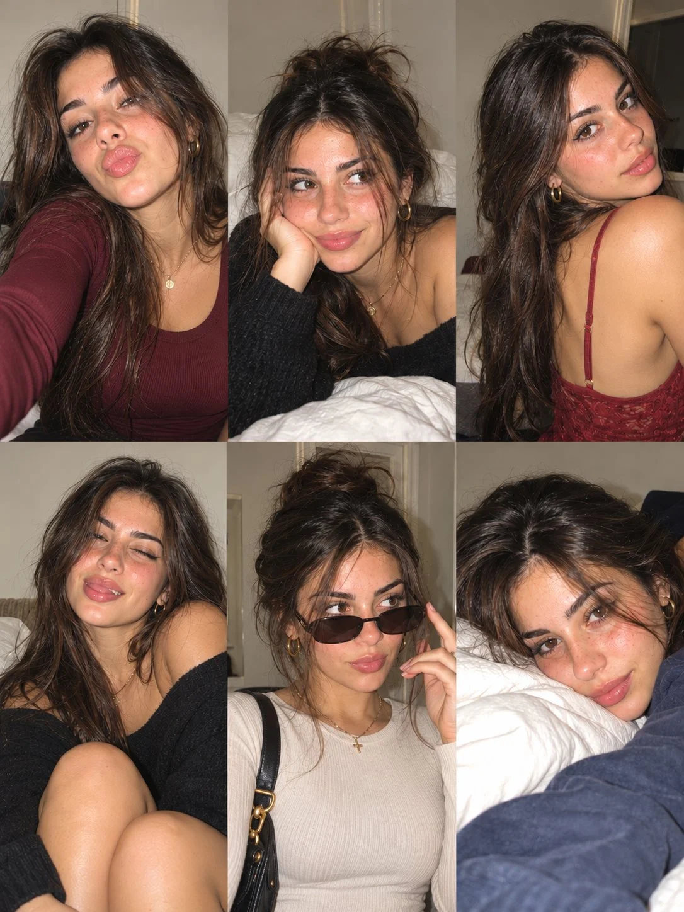

# Spanish Girl 3×2 Six-Photo Collage

**中文标题：** 西班牙女孩 3×2 六宫格拼贴  
**ID:** `gi25-x-983` · **Mode:** `generate`  
**Categories:** `general`, `character-consistency`  
**Tags:** `x-twitter`, `community`, `gpt-image-2.5`, `x-direct`, `en`



### Spanish Girl 3×2 Six-Photo Collage

```text
Create an ultra-realistic 6-photo collage arranged in a seamless 3×2 grid, featuring the same naturally beautiful Spanish woman in her early 20s. She has warm olive skin, subtle freckles across her cheeks and nose, hazel-brown eyes, long dark chestnut hair with soft face-framing layers, naturally full eyebrows, and glossy natural lips. Preserve identical facial features and identity across all six photos.

Photography Style: Authentic European Instagram photo dump, casual iPhone/compact-camera selfies, direct flash, realistic skin texture, natural imperfections, slightly messy hair, soft digital grain, candid framing, and warm indoor lighting. Avoid overly polished AI aesthetics.

Setting: A cozy bedroom with an off-white wall, white bedding, and subtle background details. Maintain a consistent environment and realistic flash shadows.

Outfits & Accessories: Burgundy fitted long-sleeve scoop-neck top, black oversized knit sweater, burgundy lace camisole, black off-shoulder knit top, cream ribbed long-sleeve top, and a navy cozy top. Keep the first and fifth outfits modest, with higher necklines and natural chest coverage. Add small gold hoop earrings and delicate gold necklaces.

Six Distinct Poses:

1. Close-up selfie with lips playfully pursed, one arm extended toward the camera, wearing a burgundy long-sleeve top with a modest neckline.
2. Lying comfortably on white bedding, cheek resting on one hand, giving a gentle, playful smile while wearing an oversized black knit sweater.
3. Turning over one shoulder toward the camera with a confident expression, long hair cascading down her back, wearing a burgundy lace top.
4. Relaxed seated selfie in a black off-shoulder knit sweater, eyes softly closed, smiling with her head tilted and hair falling naturally around her face.
5. Casual street-style selfie wearing a cream ribbed long-sleeve top with a modest neckline, dark sunglasses, a black shoulder bag, and layered gold jewelry.
6. Cozy close-up lying beside a white pillow, looking directly into the camera with a soft, thoughtful expression, wearing a navy top.

Consistency & Quality: The same woman must appear in every frame, with consistent eye color, skin tone, facial proportions, freckles, and hair color. Each photo should have a distinct pose and expression while feeling like moments captured during the same casual photo session. Realistic hands, believable anatomy, sharp eyes, authentic skin pores, natural asymmetry, and subtle exposure variations.

Output: Vertical 3:4 aspect ratio, exactly six equally sized photographs in a clean 3-column × 2-row grid, seamless alignment, no gutters, no borders, no text, no watermark. Photorealistic, youthful, spontaneous, cozy, and effortlessly stylish.
```

- **Recommended model:** `gpt-image-2.5-sunburst`
- **Settings:** _(defaults)_
- **Source:** [community](https://x.com/john_my07/status/2113253238237778319) — @john_my07
- **License note:** Original public X post; quoted with attribution — remix with attribution
- **Notes:** Collected directly from X; original post https://x.com/john_my07/status/2113253238237778319; post text names GPT Image 2.5; discovered via Bin0754/gpt-image-gallery index, prompt re-verified against the original X post via api.fxtwitter.com; verified=True
- **Preview:** `previews/gi25-x-983.webp`
