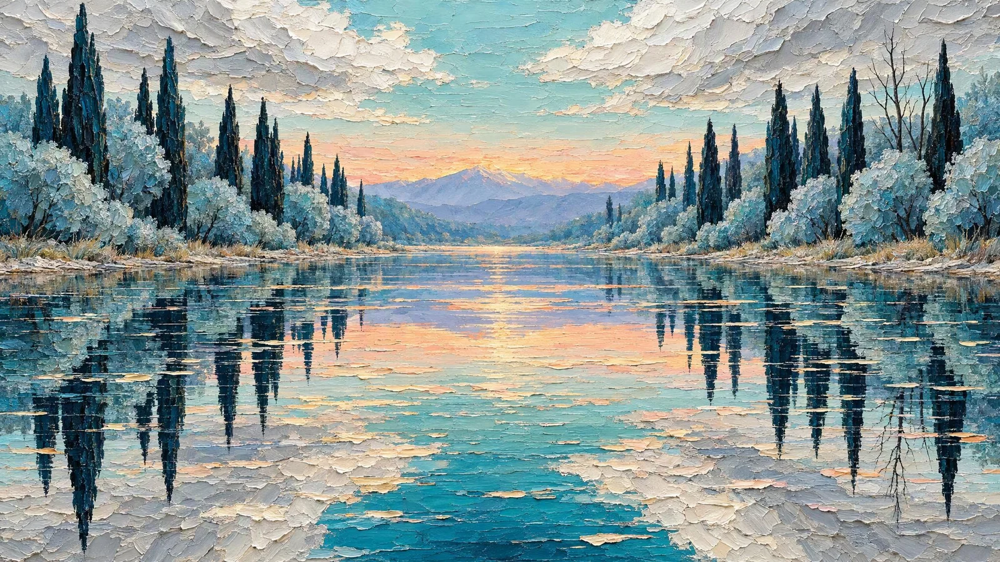

# Mirrored Lake Impasto Oil Panorama

**中文标题：** 镜面湖泊厚涂油画全景  
**ID:** `gi25-x-986` · **Mode:** `generate`  
**Categories:** `general`  
**Tags:** `x-twitter`, `community`, `gpt-image-2.5`, `x-direct`, `en`



### Mirrored Lake Impasto Oil Panorama

```text
Impasto oil painting on coarse canvas, thick sculptural palette-knife paint standing in raised ridges, wide 16:9 panoramic composition, symmetrically mirrored scene. Edge to edge, no frame, no border.

CONCEPT: a still lake splits the canvas dead centre into a perfect horizontal mirror line, the upper half the world and the lower half its exact rippled reflection.

SKY upper: pale silver-white torn cloud banks of heavy thick knife-paint, their undersides shaded grey-cream, opening in the middle to a band of soft duck-egg turquoise and pale aqua. Low on the horizon, a warm blush of peach, apricot and faint rose glows behind a distant ridge.

MOUNTAINS: a soft pale blue-lavender ridge sits in the centre distance, hazy and simple, its crest catching the warm horizon light.

TREES: on both shores stand tall slender cypresses in deep teal-blue and near-black, their surface built from dense vertical knife-scrapes. Around them cluster rounded bushy trees in pale ice-blue and silvery turquoise. The trunks are dark and faint, and thin bare branches on the right shore rise against the sky. The tree masses crowd both banks symmetrically, framing the water.

BANKS: narrow strips of pale silver-tan bank with fine grass strokes run along both sides at the waterline.

WATER: the mirror surface is painted in long horizontal knife-drags, its colour a vivid saturated turquoise shading to deep indigo, with wide pale gold and peach patches where the horizon glow reflects.

REFLECTION lower: every element repeats downward upside-down — the cypress spires pointing down, the bushy crowns as silvery fans, the sky as torn pale slabs, all of it smeared by horizontal knife ridges and broken into flat elongated flecks like floating debris.

PALETTE: teal blue, turquoise, silver-white, pale aqua, slate, peach and apricot glow, near-black cypress. Heavy tactile ridges, matte glossy paint, serene and dreamlike, clean and unmarked.
```

- **Recommended model:** `gpt-image-2.5-flare`
- **Settings:** _(defaults)_
- **Source:** [community](https://x.com/churvikv/status/2112858088373940495) — @churvikv
- **License note:** Original public X post; quoted with attribution — remix with attribution
- **Notes:** Collected directly from X; original post https://x.com/churvikv/status/2112858088373940495; post text names GPT Image 2.5; discovered via Bin0754/gpt-image-gallery index, prompt re-verified against the original X post via api.fxtwitter.com; verified=True; author says it was created on GMI Cloud with GPT Image 2.5 Flare
- **Preview:** `previews/gi25-x-986.webp`
