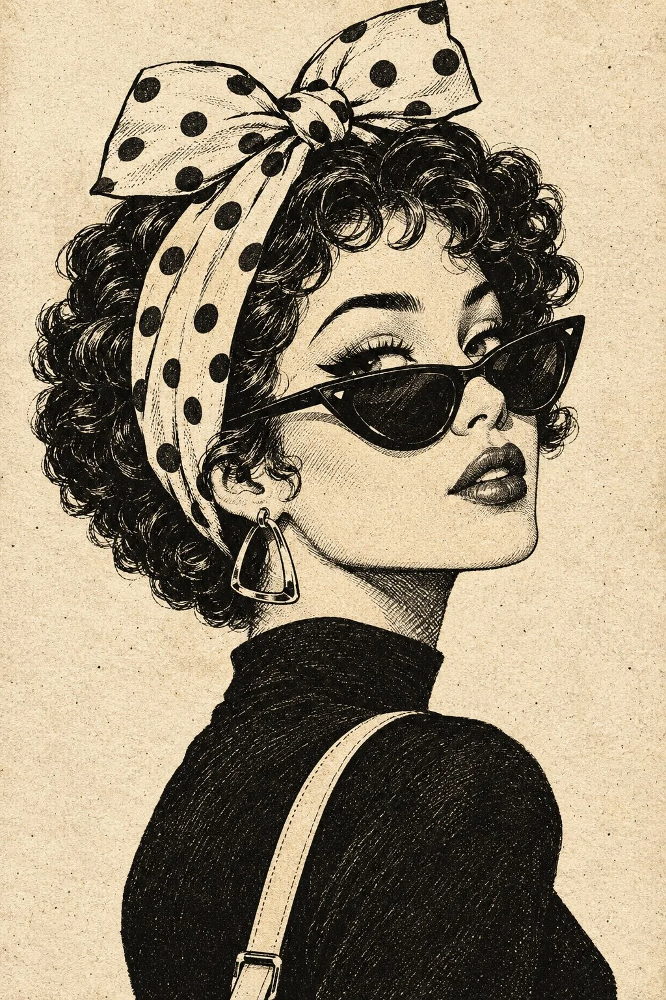

# Vintage Fashion Illustration Over-the-Shoulder (JSON)

**中文标题：** 复古时装插画回眸（JSON）  
**ID:** `gi25-x-993` · **Mode:** `generate`  
**Categories:** `general`  
**Tags:** `x-twitter`, `community`, `gpt-image-2.5`, `x-direct`, `en`



### Vintage Fashion Illustration Over-the-Shoulder (JSON)

```text
{
  "prompt": "Create a highly detailed vintage fashion illustration of a stylish young adult woman in a three-quarter side profile, looking confidently over her shoulder toward the viewer. She has voluminous short black curly hair with individually defined ringlets, dramatic winged eyeliner, long eyelashes, a small nose, and full glossy lips. She wears oversized pointed cat-eye sunglasses with dark lenses and thick black frames. A wide cream-colored headscarf with bold black polka dots wraps around her head and forms a large playful bow on top. A large geometric hoop earring hangs from her visible ear. She wears a dark, elegant high-neck top with a light-colored shoulder strap crossing diagonally over her shoulder. Her chin is slightly raised, her head tilted back, and her expression is effortlessly confident and fashionable. Use expressive black ink outlines, intricate cross-hatching, dense hand-drawn curls, fine facial linework, bold solid-black shadow areas, and subtle distressed print textures. The background is warm ivory paper with visible grain, tiny ink speckles, and an aged screen-printed finish. Strong contrast between black ink and off-white paper, sophisticated retro editorial composition, authentic vintage comic-book print quality, clean recognizable silhouette, beautifully balanced negative space.",

  "composition": {
    "framing": "vertical portrait, head to upper torso",
    "camera_angle": "slightly low three-quarter profile",
    "subject_position": "centered, face turned toward the right",
    "pose": "looking back over her shoulder with chin slightly raised",
    "background": "minimal textured ivory paper"
  },
  "color_palette": {
    "primary": "deep ink black",
    "secondary": "warm ivory",
    "accents": "soft antique cream"
  },
  "lighting": "illustrative high-contrast tonal shading, no realistic photographic lighting",
  "texture": "rough ink grain, distressed paper, vintage halftone speckles, fine cross-hatching",
  "negative_prompt": "photorealism, 3D render, color gradients, bright colors, smooth digital vector art, glossy plastic skin, blurry facial features, asymmetrical eyes, malformed sunglasses, extra earrings, distorted hands, messy outlines, low detail, text, typography, watermark, logo, frame"
}
```

- **Recommended model:** `gpt-image-2.5-sunburst`
- **Settings:** _(defaults)_
- **Source:** [community](https://x.com/Just_Anika_Here/status/2114206456518148577) — @Just_Anika_Here
- **License note:** Original public X post; quoted with attribution — remix with attribution
- **Notes:** Collected directly from X; original post https://x.com/Just_Anika_Here/status/2114206456518148577; post text names GPT Image 2.5; discovered via Bin0754/gpt-image-gallery index, prompt re-verified against the original X post via api.fxtwitter.com; verified=True; prompt is posted as a JSON object; the opening brace is restored
- **Preview:** `previews/gi25-x-993.webp`
