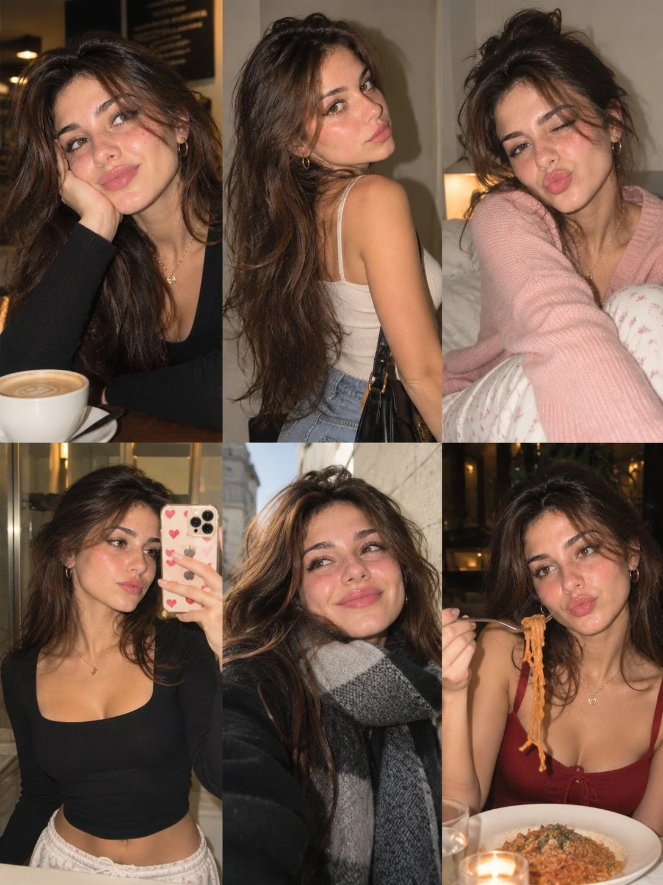

# European Girl 3×2 Six-Photo Lifestyle Collage

**中文标题：** 欧洲女孩 3×2 六宫格生活拼贴  
**ID:** `gi25-x-994` · **Mode:** `generate`  
**Categories:** `general`, `character-consistency`  
**Tags:** `x-twitter`, `community`, `gpt-image-2.5`, `x-direct`, `en`



### European Girl 3×2 Six-Photo Lifestyle Collage

```text
Create an ultra-realistic 6-photo lifestyle collage arranged in a seamless 3×2 grid, featuring the same naturally beautiful young European woman in her early 20s. She has warm olive skin, delicate freckles across her cheeks and nose, hazel-brown eyes, long chestnut-brown hair with natural waves and subtle highlights, full eyebrows, and glossy pink lips. Preserve the same recognizable facial identity across all six photographs.

Overall aesthetic: Authentic European Instagram photo dump, candid smartphone photography mixed with compact-camera flash, realistic skin texture, subtle digital grain, natural lighting, imperfect framing, spontaneous expressions, and a warm cinematic color palette. Every frame should feel like a genuine moment from her everyday life, not a professional studio shoot.

Six different scenes, outfits, and poses:

1. Cozy café moment: Sitting at a wooden café table in a fitted black long-sleeve top, resting her cheek against one hand and smiling gently at the camera. A white cappuccino cup sits in front of her, with warm pendant lights and a softly blurred café background.

2. Casual street-style portrait: Standing indoors near a neutral wall, wearing a cream fitted tank top, light-wash blue jeans, and carrying a black shoulder bag. She turns over her shoulder to look back at the camera, with her long hair cascading naturally down her back.

3. Cozy bedroom snapshot: Sitting on a white bed in a soft pastel-pink knit cardigan and white floral lounge pants. She hugs one knee casually, winks at the camera, and makes a playful pout. Warm bedside lighting creates a relaxed evening atmosphere.

4. Mirror selfie: Taking a casual mirror selfie in a fitted black square-neck long-sleeve top and white lounge pants. Her phone has a cute heart-patterned case. She looks at her reflection with a subtle, confident expression in a softly lit bedroom or hallway.

5. Outdoor winter portrait: Wearing a charcoal coat and a thick grey knitted scarf, with her long hair loose around her face. She looks slightly upward with a gentle smile while standing on a European street in soft natural daylight.

6. Restaurant dinner moment: Sitting at a restaurant table wearing a tasteful burgundy sleeveless top with a modest neckline and delicate gold jewelry. She playfully lifts a forkful of spaghetti while glancing toward the camera. A plate of pasta, warm candlelight, and softly blurred restaurant lights complete the scene.

Identity consistency: The same woman must appear in every panel, with identical facial proportions, eye color, freckles, skin tone, and hair color. Her hairstyle may vary naturally between scenes, including loose waves and slightly messier strands, while remaining recognizable.

Realism details: Authentic skin pores, fine baby hairs, natural facial asymmetry, realistic hands, believable fabric textures, subtle exposure differences, realistic reflections, and natural environmental lighting. Avoid excessive retouching, plastic skin, duplicated expressions, distorted fingers, inconsistent facial features, or overly polished AI-generated aesthetics.

Output requirements: Vertical 3:4 aspect ratio, exactly six equally sized photographs in a balanced 3-column × 2-row grid, clean alignment, no gutters, no borders, no text, no watermark. Photorealistic, youthful, spontaneous, stylish, and full of personality, like a genuine collection of everyday moments shared on Instagram.
```

- **Recommended model:** `gpt-image-2.5-sunburst`
- **Settings:** _(defaults)_
- **Source:** [community](https://x.com/john_my07/status/2114371973002506481) — @john_my07
- **License note:** Original public X post; quoted with attribution — remix with attribution
- **Notes:** Collected directly from X; original post https://x.com/john_my07/status/2114371973002506481; post text names GPT Image 2.5; discovered via Bin0754/gpt-image-gallery index, prompt re-verified against the original X post via api.fxtwitter.com; verified=True
- **Preview:** `previews/gi25-x-994.webp`
